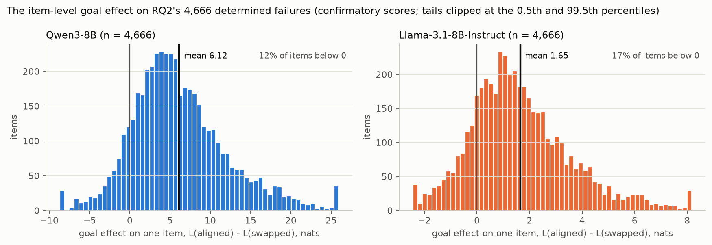
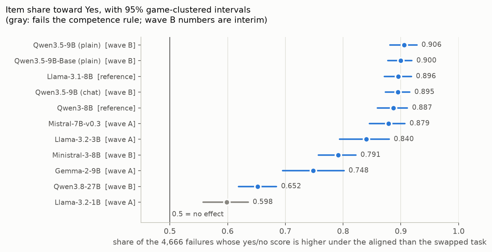
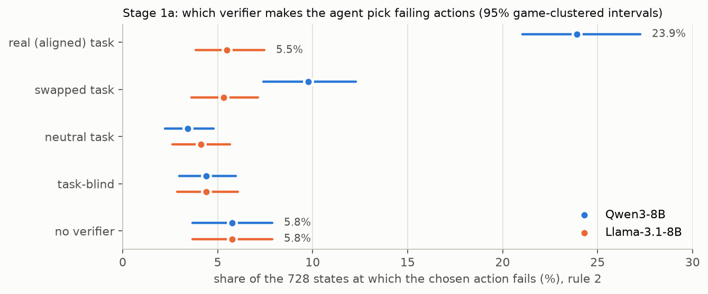
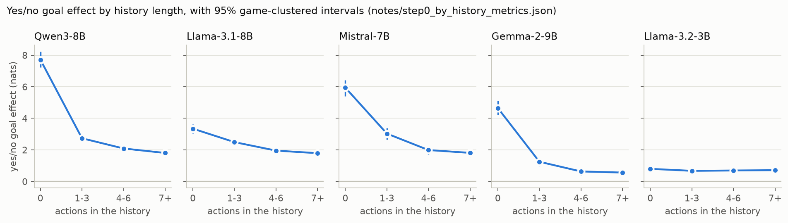

# ALFWorld walkthrough: the benchmark, the test items, the scoring, and real sample decisions

This document walks through the ALFWorld part of the project from the ground up, using real items and real stored scores. It is one of a set: [00_overview.md](00_overview.md) gives the project as a whole, and [02_textcraft.md](02_textcraft.md) and [03_taubench.md](03_taubench.md) do the same job for the other two environments. Section 1 explains the benchmark itself, Section 2 how the project turns it into test items, and Section 3 how a model's prediction becomes a number. Section 4 then shows twelve failing actions and two working ones in full, with every model's scores. Section 5 goes through every study run on ALFWorld, each with a sample item shown under that study's own conditions, and Section 6 is a glossary.

**Where the numbers come from.** Every headline number is quoted from a committed results note or metrics file in `notes/`, which is named each time. Every number in a sample table is a stored score read from the run archive by the scripts in `scripts/walkthroughs/` (`alfworld_samples.py`, `alfworld_decisions.py`), checked against the item hash stored with it, and printed into this file by `alfworld_tables.py`. No number in a sample table is typed by hand. The extracted values are committed in `notes/walkthroughs/data/` (`alfworld_samples.json`, `alfworld_decisions.json`). The run archive itself is not public (`notes/reproducing.md`, section 2), but the inputs of the preregistered RQ2 analysis are, as the GitHub release `repro-rq2-2026-11-25`. Studies whose analysis had not run when this was written (the controlled Bayesian environment, the natural bridge, the lexical-versus-semantic diagnostic and the post-training pilot) are not shown.

**Licensing.** ALFWorld's game text, which makes up every history, action and reply below, is ALFWorld's own (MIT licence; [DATA_LICENSES.md](../../DATA_LICENSES.md)). One field of each collected item, a starting-layout description copied from Word2World's data, has no licence; it is never quoted here, and the full-state prompts that show it are described but not printed. Model outputs quoted below are from Qwen3-8B (Apache-2.0) and Llama-3.1-8B-Instruct (Llama 3.1 Community License, which does not restrict outputs used this way).

**Reading the equations.** Log-probabilities are natural logarithms, and a difference of two of them is measured in **nats**. One nat multiplies the odds by about 2.7; five nats multiply them by about 150.

---

## 1. The benchmark itself

### 1.1 What ALFWorld is and where it comes from

ALFWorld is a text-only household game. It was built by turning the household tasks of ALFRED, a dataset of 3D household scenes and instructions, into text adventures rendered by Microsoft's TextWorld engine. The agent reads a description of a room, receives a one-line task such as "put two soapbar in garbagecan", and types short commands until the task is done or a step limit is reached. Nothing is visual: the agent only ever sees text.

In this project "ALFWorld" means one specific build. The game files are ALFWorld's own (byte-identical to the files in ALFWorld's GitHub releases, checked on 2026-11-25), downloaded through the Word2World project's script and served by the AgentGym server that ships with Word2World (checkout `e8dc240`), running alfworld 0.3.3 and TextWorld 1.7.0. The commands use the wording ALFWorld introduced in its version 0.4.0, in which putting an object somewhere is `move X to R`. Games come from ALFWorld's `valid_unseen` split, whose rooms were never seen in ALFWorld's training split. That split lists 195 games; 134 of them start correctly on this server and the other 61 crash on reset, so every study uses the 134 solvable games. The environment ends every episode after 50 steps. (Sources: `notes/rq2_results.md`, "Methods"; `notes/reproducing.md`, section 1; `DATA_LICENSES.md`.)

**Task types.** Every ALFWorld task belongs to one of six templates, and all six appear among the samples below:

- put an object somewhere ("put some vase on safe");
- put two objects of one type somewhere ("put two cd in safe");
- examine an object under a lamp ("look at mug under the desklamp", "examine the cd with the desklamp");
- clean an object, then put it somewhere ("clean some soapbar and put it in cabinet");
- heat an object, then put it somewhere ("heat some apple and put it in garbagecan", also written "put a hot potato in garbagecan");
- cool an object, then put it somewhere ("cool some lettuce and put it in countertop").

### 1.2 What an observation and an action look like

At reset the agent receives one observation: a sentence listing every receptacle in the room, followed by the task. Here is the opening observation of game `valid_unseen/191`, the game of the project's golden test item:

```
You are in the middle of a room. Looking quickly around you, you see a cabinet 4, a cabinet 3, a cabinet 2, a cabinet 1, a countertop 1, a garbagecan 1, a handtowelholder 2, a handtowelholder 1, a sinkbasin 2, a sinkbasin 1, a toilet 1, a toiletpaperhanger 1, and a towelholder 1.
Your task is to: put two soapbar in garbagecan.
```

A **receptacle** is anything that can hold objects (a cabinet, a countertop, a fridge). An **object** is anything that can be carried (a soap bar, a mug). Both are named by a type and an instance number ("cabinet 1", "soapbar 2"). The opening observation names every receptacle but no object: the agent has to go and look.

The agent's commands come from a small grammar. The ones that matter here are:

- `go to R`: walk to receptacle R; the reply describes R ("You arrive at cabinet 1. The cabinet 1 is closed." or "You arrive at shelf 2. On the shelf 2, you see a dishsponge 1, a mug 2, and a vase 2.");
- `open R` and `close R`: the reply to opening lists what is inside ("You open the fridge 1. The fridge 1 is open. In it, you see a apple 1, a bread 1, ...");
- `take X from R`: pick X up ("You pick up the soapbar 1 from the cabinet 1.");
- `move X to R`: put the held X into or onto R ("You move the potato 1 to the fridge 1.");
- `heat X with R`, `cool X with R`, `clean X with R`: use the microwave, fridge or sink basin on the held X ("You cool the bread 1 using the fridge 1.");
- `use R` (switch on a lamp), `examine X`, `look`, `inventory`.

Here are the first steps that the project's Qwen3-8B agent actually took in game 191 when it played without any predictions (the RQ3 "no foresight" episode, stored in the `rq3` run). Each line starting with `>` is the agent's command; the line after it is the game's reply.

```
> go to cabinet 1
You arrive at cabinet 1. The cabinet 1 is closed.
> examine cabinet 1
The cabinet 1 is closed.
> open cabinet 1
You open the cabinet 1. The cabinet 1 is open. In it, you see a cloth 2.
> go to cabinet 2
You arrive at cabinet 2. The cabinet 2 is closed.
> open cabinet 2
You open the cabinet 2. The cabinet 2 is open. In it, you see a cloth 3, and a soapbottle 2.
```

This episode did not finish the task within its 30-step cap: the agent searched cabinets without finding the soap bars.

### 1.3 What makes an action succeed or fail

The game has preconditions that are simple to state. The project's mechanism diagnostic wrote them out in one paragraph (`wf/mech.py`, `RULES`); it is a faithful summary of how the server behaves:

> Rules of this environment: the agent can take an object from, put an object in or on, open or close a receptacle, or heat, cool or clean an object with one, only when it is at that receptacle (or at another receptacle in the same spot of the room). It cannot take an object from, or put one into, a closed receptacle. It holds at most one object, so it can take an object only when its hands are empty, and only if the object is in or on that receptacle. It must be holding an object to put it somewhere or to heat, cool or clean it. When an action is not possible, the environment replies "Nothing happens."

Two facts in this rule matter for everything below. First, **every failing action gets the same reply**, the two words "Nothing happens." The game never says why. Second, the preconditions depend only on the state of the room (where the agent is, what it holds, what is open, what is where) and on the action. They do not depend on the task. A closed cabinet stays closed whether the agent wants a soap bar or a spray bottle.

The parenthesis "or at another receptacle in the same spot" describes a quirk: some receptacles share a position, so from `cabinet 1` the agent can act on `cabinet 2` without going there. Such actions are called **shared spots** below and are excluded, because there "the agent is elsewhere" proves nothing.

### 1.4 What is hidden from the agent, and what the history reveals

The full state of a room is the position of every object, which receptacles are open, where the agent stands and what it holds. The agent sees almost none of it at the start: the opening observation lists receptacles, never objects. It learns the contents of a receptacle only by going to it (and opening it if it is closed). So at any step, the **history** (the opening observation plus every command and reply so far) reveals:

- where the agent is: the last "You arrive at ..." line;
- what it holds: the last "You pick up ..." not followed by "You move ...";
- which receptacles are known open or closed;
- the last-seen contents of each receptacle it has looked into.

Everything else (for example where the soap bar actually is) is hidden. The project's items are chosen so that the hidden part does not matter: the history alone is enough to tell that the action fails.

### 1.5 Why the replies are deterministic

After reset the server has no randomness: the same command in the same state always gets the same reply. A state can therefore be rebuilt exactly by replaying its saved command prefix from reset, which is how every item below was checked (`wf/env/replay.py`). In the notation of the project's question, with the state at step $t$ written $s_t$, the action $a_t$ and the task (goal) $g$,

$$
P(s_{t+1} \mid s_t, a_t, g) = P(s_{t+1} \mid s_t, a_t),
$$

and in ALFWorld the right-hand side puts all its probability on one reply. A world model that has learned the game should therefore give the same prediction under any task. The project tests whether it does.

---

## 2. From games to test items

### 2.1 Collecting histories and candidate actions

An **item** is one history plus one next action, together with the action's true reply. Items were collected as follows (`notes/rq2_results.md`, "Methods"; code `wf/data/transitions.py`).

1. A Qwen3-8B ReAct agent (greedy decoding, thinking off, shown the real task and the list of admissible actions, no predictions) played each of the 134 games once from reset. A ReAct agent writes a short "Thought:" and then an "Action:" line at each step. The collector stopped each episode after 12 steps, so a history holds at most 11 actions.
2. At the states along each episode, two generators proposed **alternative actions**, and each was executed on a fresh replay of the state to record its true reply. The broad generator (run at every second step, and at any step where the agent's own action failed) proposes taking the task's object from various receptacles, moving it to the target type, heating, cooling and cleaning it, wrong-object versions of the agent's action, and three random admissible actions. The exhaustive generator covers every failure that the agent's own receptacle decides (contents, open state, holding).

This produced 12,987 items from the 134 games. The agent's actions in the histories are Qwen3-8B's, but every observation is the real server's text.

### 2.2 When a failure counts as "determined"

A failure is **determined** when the history alone proves it (`_failure_determined` in `wf/data/transitions.py`). The rules read the history facts of Section 1.4:

- `take X from R` fails if the agent is known to hold something, is known to be somewhere other than R, R is known to be closed, or R's contents were seen and X was not among them;
- `move`, `heat`, `cool` and `clean` fail if the agent is known not to hold X, or is known to be away from R;
- `open R` fails if the agent is away or R is known open (and `close` symmetrically); `go to R` fails if the agent is already at R or R is not in the room.

Each determined failure is tagged with the single fact that decides it (`determination_reason`). Among RQ2's 4,666 items these are: the agent is away from the receptacle after moving elsewhere (1,895 items), the agent has not moved yet at all (527), the receptacle's contents or open state rule it out (1,107), the action needs the object in hand and the agent does not hold it (960), and the agent's hands are full (177). The samples in Section 4 cover all five.

A **determined success** is a working action whose reply reveals nothing new (for example taking an object the history showed on the receptacle where the agent stands). These are used to check that a model can tell working from failing actions at all.

### 2.3 Replay verification and the success twin

Every collected item was replayed on CPU (`wf/tools/verify_items.py`): the history and the true reply must reproduce exactly, no item the rules call a sure failure may have succeeded, and contents-decided failures were cross-checked against an independent record of the starting layout. Scoring refuses any collection shard without a full pass.

The main readout (Section 3) compares the failure reply "Nothing happens." with a **success reply**. That sentence is never written by hand. For each failing action, `wf/data/candidates.py` builds a short plan from reset (go to the object's receptacle, open it, take the object, carry it to the action's receptacle), replays it, and executes the action; the real server's reply is the item's **success twin**. For `take soapbar 1 from cabinet 1` the twin is "You pick up the soapbar 1 from the cabinet 1." Twins of `open` and `go to`, whose replies list contents, are dropped once the agent has changed that receptacle, and actions with no workable plan have no twin.

### 2.4 The exclusion flow

The preregistered RQ2 population is every determined failure that names the task's object, whose history has not yet acted on that object (or on the swap object), that has a success twin and a swapped task, and that is not at a shared spot. The table, copied from `notes/rq2_results.md` ("Exclusion flow", from `notes/audit_metrics.json`), shows how 12,987 items become 4,666. Each row applies one rule to what is left.

| Items are kept if... | Dropped | Remaining | Games |
| --- | --- | --- | --- |
| collected | | 12,987 | 134 |
| the true reply is "Nothing happens." | 3,120 | 9,867 | 134 |
| the reply could be parsed | 0 | 9,867 | 134 |
| the history determines the failure | 41 | 9,826 | 134 |
| a success twin exists and fits the state | 2,640 | 7,186 | 134 |
| a swapped goal object exists | 658 | 6,528 | 125 |
| the action is not at a shared spot | 1 | 6,527 | 125 |
| the action names the goal object | 861 | 5,666 | 125 |
| the history does not act on the goal or swap object | 1,000 | 4,666 | 125 |

The 4,666 items come from 1,033 states in 125 games; nine games have no usable swap object at all. The 6,527 items left after the shared-spot rule are the true failures that RQ1 uses, and 307 determined successes (292 of them with a swap object) serve as working actions.

### 2.5 The task lines: aligned, swapped, neutral and task-blind

Every study changes one thing between paired prompts: the **task line**, the sentence "Your task is to: ..." in the history. Everything else is byte-identical; the code refuses to run unless exactly one task line is replaced (`wf/scoring/prompts.py`, `_replace_task_line`). Each version of the prompt is a **condition** (later studies say **arm**). For the golden item (`take soapbar 1 from cabinet 1`, cabinet 1 closed) the four basic conditions are:

- **Aligned**: the episode's real task, which names the action's object: "Your task is to: put two soapbar in garbagecan."
- **Swapped**: the same template with another object: "Your task is to: put two spraybottle in garbagecan."
- **Neutral**: a task that names no object: "Your task is to: explore the room."
- **Task-blind**: the task sentence deleted, every other byte kept (used only in the decision studies).

The swap object is drawn per item among the room's object types that are not the task's object, are not named in the action, have not been acted on in the history, have no instance at the action's receptacle at reset, and could do the task by the game's own rules (`wf/data/goals.py`, `pick_swap`). So the swapped task is a realistic task for the same room; only the object differs.

**Why aligned against swapped is the main contrast.** Any concrete task lowers predicted success on actions that have nothing to do with it, compared with "explore the room". On determined successes that take some other object, Qwen3-8B's yes/no score falls by 13.30 nats from neutral to aligned but by only 0.43 from swapped to aligned (`notes/exploratory_results.md`, section 7). The project calls this the **relevance penalty**. Aligned and swapped are both concrete tasks in the same template, so the penalty is present in both and cancels in their difference; what remains is the effect of which object the task names. That difference is the **goal effect**.

---

## 3. How a prediction is scored

### 3.1 The prompt

The world model is an instruction-tuned language model prompted to predict the next observation. The prompt is a chat: a system message, three worked examples (each a user turn with a history and an action, and an assistant turn with the true reply), and finally the item's own history and action (`wf/scoring/prompts.py`, `world_model_prompt`; `wf/scoring/logodds.py`, `build_messages`). The three examples (example set 1, frozen before the preregistration) are real server text from three training games: one success and two failures.

Here is the complete scored prompt of the golden item under the aligned task, as Qwen3-8B saw it: the message list built by the repository's own builder and rendered through the chat template of the pinned Qwen3-8B snapshot (`b968826`) with thinking off (`scripts/walkthroughs/alfworld_render_qwen.py`). The tags `<|im_start|>` and `<|im_end|>` are Qwen's turn markers.

```
<|im_start|>system
You are a text world model for household embodied tasks. Given the interaction history and the next action, predict the environment's next observation exactly in ALFWorld style. Output only the observation text.<|im_end|>
<|im_start|>user
History:
Your task is to: put a soapbottle in toilet.
> go to cabinet 1
You arrive at cabinet 1. The cabinet 1 is closed.
> open cabinet 1
You open the cabinet 1. The cabinet 1 is open. In it, you see a spraybottle 1.

Action: take spraybottle 1 from cabinet 1

Next observation:<|im_end|>
<|im_start|>assistant
You pick up the spraybottle 1 from the cabinet 1.<|im_end|>
<|im_start|>user
History:
Your task is to: put some candle on cabinet.
> go to toilet 1
You arrive at toilet 1. On the toilet 1, you see a candle 2, and a candle 1.
> take candle 1 from toilet 1
You pick up the candle 1 from the toilet 1.

Action: move candle 1 to cabinet 1

Next observation:<|im_end|>
<|im_start|>assistant
Nothing happens.<|im_end|>
<|im_start|>user
History:
Your task is to: put two soapbottle in garbagecan.
> move soapbottle 2 to garbagecan 1
You move the soapbottle 2 to the garbagecan 1.
> go to countertop 1
You arrive at countertop 1. On the countertop 1, you see a handtowel 1, a soapbar 1, a spraybottle 3, and a spraybottle 1.

Action: take soapbottle 1 from countertop 1

Next observation:<|im_end|>
<|im_start|>assistant
Nothing happens.<|im_end|>
<|im_start|>user
History:
You are in the middle of a room. Looking quickly around you, you see a cabinet 4, a cabinet 3, a cabinet 2, a cabinet 1, a countertop 1, a garbagecan 1, a handtowelholder 2, a handtowelholder 1, a sinkbasin 2, a sinkbasin 1, a toilet 1, a toiletpaperhanger 1, and a towelholder 1.
Your task is to: put two soapbar in garbagecan.
> go to cabinet 1
You arrive at cabinet 1. The cabinet 1 is closed.

Action: take soapbar 1 from cabinet 1

Next observation:<|im_end|>
<|im_start|>assistant
<think>

</think>


```

The swapped prompt is the same text with `put two soapbar in garbagecan` replaced by `put two spraybottle in garbagecan` in the last user turn; the examples keep their own task lines in every condition. This exact message list is stored as the repository's golden fixture (`tests/golden/default_prompt.json`), and a test asserts that the builder reproduces it.

**The empty think block.** The last lines matter. Qwen3 models can reason inside a `<think>` block before answering. With thinking turned off, Qwen3's own template writes an *empty* think block (`<think>`, a blank line, `</think>`, two newlines) after the assistant header, and the scored answer follows it. The three example answers above have no such block, because the template only adds it after the last user turn. This is Qwen3's documented thinking-off format, identical in every condition. An audit later found that it roughly doubles Qwen3-8B's effects in nats without changing their size relative to the spread of the scores (Section 3.6).

Other models see the same message list through their own chat template; the golden renders for Gemma-2-9B, Mistral-7B-v0.3 and Llama-3.2 are stored in `tests/golden/families_rendered.json`. Gemma's template has no system role, so the system text is folded into the first user turn; Mistral's template places it after the examples, which a placement check found does not change the conclusions (`notes/families_results.md`).

### 3.2 Teacher forcing

No text is generated for the main readouts. Instead each candidate reply is **teacher-forced**: it is appended to the prompt token by token, and the model's log-probability of each token given everything before it is added up. For a candidate with tokens $o_1, \dots, o_n$ after the prompt $x$,

$$
\log P(o \mid x) = \sum_{k=1}^{n} \log P(o_k \mid x, o_1, \dots, o_{k-1}).
$$

Weights are loaded in bfloat16, and log-probabilities are taken in float32 from the bfloat16 logits (`LogoddsScorer._teacher_force_logprob`).

### 3.3 The readouts

A **readout** turns the model's response to one prompt into one number. Four are used on ALFWorld.

**Two-candidate log-odds.** The success twin $o^{+}$ and the failure reply $o^{-}$ ("Nothing happens.") are both teacher-forced after the prompt, and

$$
L = \log P(o^{+} \mid x) - \log P(o^{-} \mid x).
$$

A positive value means the model finds the exact success sentence more probable than "Nothing happens." This is the preregistered readout of RQ2. Its logistic,

$$
s = \sigma(L) = \frac{1}{1 + e^{-L}},
$$

is logged as `p_success` and called the **score** below. It is not the model's probability that the action succeeds: it compares one particular success wording with the failure reply, so every detail of the success sentence that the model cannot guess (which instance number, which receptacle) lowers it. The project calls that cost the **wording penalty** (`notes/deviations.md`, "Decision 5 in detail").

**First-token log-odds.** The same pass also gives the log-probability of each candidate's first token alone. On every ALFWorld failing item the success twin begins with "You" and the failure with "Nothing", so

$$
L_{\text{first}} = \log P(\text{You} \mid x) - \log P(\text{Nothing} \mid x)
$$

is the model's preference between the two opening words, before any object name appears. It is the closest teacher-forced quantity to a pure success-or-failure decision. Its difference from $L$ estimates the wording penalty (stored as `c_hat`), and the probability the two tokens cover together is stored as `first_mass`.

**Yes/no question.** The prompt's last words "Next observation:" are replaced by a fixed question (`wf/rq1v.py`, `YN_QUESTION`):

```
Question: will this action succeed, or will the environment reply "Nothing happens."? Answer Yes if it succeeds and No if nothing happens.
Answer:
```

and the readout is the log-odds of the single answer tokens,

$$
L_{\text{yn}} = \log P(\text{Yes} \mid x) - \log P(\text{No} \mid x).
$$

The question is **anchored**: it names the environment's actual failure reply, so "No" means "the environment will print Nothing happens.", not "this does not help the task". Because both candidates are one token and the same for every item, this readout has no wording penalty and means the same thing for every model, which is why the cross-family studies use it. Its known weakness is that a model can still partly read it as "will this action succeed at the task?" (Section 5.16).

**Written prediction.** For RQ1 the model writes its own prediction (greedy decoding, at most 64 new tokens), and a rule-based parser (`wf/scoring/parser.py`) sorts it into classes: `noop` ("Nothing happens."), `noop_paraphrase` (failure in other words), `state_change` (the success sentence or one like it), `success_paraphrase`, `process_only`, `different_effect`, and others. A prediction counts as predicting failure only if it states no effect.

### 3.4 A worked numerical example: the golden item

The golden item is game 191 at step 1: the agent went to cabinet 1 and saw that it is closed, and the next action is `take soapbar 1 from cabinet 1`. The true reply is "Nothing happens." (the cabinet is closed); the success twin is "You pick up the soapbar 1 from the cabinet 1." These are the stored confirmatory scores (`rq2_score`):

<!-- TABLE:S1_rq2 -->
| Model | Task line | Log-probability of the success twin | Log-probability of "Nothing happens." | Two-candidate log-odds | Score (logistic of the log-odds) | First-token log-odds | Written prediction (parser class) |
|---|---|---|---|---|---|---|---|
| Qwen3-8B | aligned | −13.56 | 0.00 | −13.56 | 0.000 | −6.25 | "Nothing happens." (noop) |
| Qwen3-8B | swapped | −17.62 | 0.00 | −17.62 | 0.000 | −9.00 | "Nothing happens." (noop) |
| Llama-3.1-8B | aligned | −0.36 | −4.99 | +4.63 | 0.990 | +4.87 | "You pick up the soapbar 1 from the cabinet 1." (state_change) |
| Llama-3.1-8B | swapped | −3.45 | −2.03 | −1.42 | 0.195 | +1.38 | "You can't take the soapbar 1 from the cabinet 1 because it is empty." (noop_paraphrase) |
<!-- /TABLE -->

Take Llama-3.1-8B under the aligned task. The 14 tokens of the success twin have a summed log-probability of −0.358, and the 3 tokens of "Nothing happens." have −4.987, so

$$
L = -0.358 - (-4.987) = 4.629, \qquad s = \sigma(4.629) = 0.990 .
$$

Llama strongly prefers the success sentence: it predicts that the agent picks up the soap bar from a cabinet it has just been told is closed. Under the swapped task the same two sentences get −3.451 and −2.035, so $L = -1.416$ and $s = 0.195$. The **goal effect on this item** is

$$
\Delta L = L(\text{aligned}) - L(\text{swapped}) = 4.629 - (-1.416) = 6.045 \text{ nats}.
$$

The first token tells the same story more modestly. Under the aligned task Llama gives "You" a log-probability of −0.031 and "Nothing" −4.906, so its first-token log-odds is 4.875; under the swapped task it is 1.375. The first-token goal effect is therefore 3.50 nats, and the remaining 2.55 nats of the 6.05 lie in the rest of the success sentence after "You" (the "success tail"): naming the soap bar in the task also makes the words "pick up the soapbar 1 from the cabinet 1" more probable. The two first tokens cover 98% of Llama's next-token probability under the aligned task (`first_mass` 0.977) but only 72% under the swapped one, a reminder that for Llama a good part of the probability goes to other first words.

Qwen3-8B is far more confident that this action fails: "Nothing happens." has a log-probability of about −0.002 under the aligned task, so $L = -13.565 - (-0.002) = -13.563$, and $s$ is about one in a million. Under the swapped task $L = -17.616$. Its goal effect is still 4.05 nats in the same direction (2.75 on the first token), but both prompts sit so far below zero that its written prediction is "Nothing happens." under both. This is the pattern Section 4 shows again and again: the task moves Qwen3-8B's scores a lot in nats while rarely changing its answer, and moves Llama-3.1-8B's less in nats while often changing its answer.

### 3.5 From items to an effect estimate

The study-level goal effect is the mean of the item-level differences,

$$
\Delta L = \frac{1}{N}\sum_{i=1}^{N}\left[L_i(\text{aligned}) - L_i(\text{swapped})\right],
$$

over the $N$ items, so each item counts equally. Items are not independent: the 4,666 items come from 125 games, from 4 to 90 per game. Intervals are therefore **game-clustered bootstraps** (whole games are resampled with replacement, 2,000 times, and the 2.5th and 97.5th percentiles of the recomputed mean form the 95% interval), and p-values come from a **game-level sign-flip permutation test** (all differences in a game flip sign together, 1,000 times; the smallest possible p is 1/1001). The preregistered decision rule (`wf/analysis/stats.py`, `prereg_rq2_verdict`) calls a model's effect "supported" if it is at least 0.5 nats with an interval excluding zero and a Holm-corrected p below 0.01, and "supported (strong)" at 1.0 nats or more.

Figure 1 shows the item-level differences behind the two co-primary means.



*Figure 1. The goal effect on each of the 4,666 determined failures, aligned minus swapped two-candidate log-odds, from the confirmatory scores. Look at how much of each distribution lies right of the gray line at zero (88% and 83% of items) and how far Qwen3-8B's spreads compared with Llama-3.1-8B's: the means differ almost fourfold in nats, but so do the spreads. Tails beyond the 0.5th and 99.5th percentiles are piled into the end bins.*

Several other summaries are used because a mean in nats does not say how many predictions change, and because different models spread their scores over very different ranges:

- the **standardized effect**: the mean item difference divided by the standard deviation of the item differences (scale-free);
- the **share of items moved toward success** (or "toward Yes"): the share of items whose score is higher under the aligned than under the swapped task; 0.5 means no effect;
- **flips**: items whose answer changes, for example a yes/no score at or below zero under the swapped task and above zero under the aligned one.

### 3.6 What is known about the readouts' own distortions

Three findings about the measurement itself recur in the samples, so they are stated once here.

- **The success tail.** The two-candidate effect splits exactly into a first-token part and a tail part. For Qwen3-8B, 3.60 of the 6.12 nats (59%) are in the success sentence's tail, for Llama-3.1-8B 0.96 of 1.65 (58%) (`notes/textcraft_vs_alfworld.md`, section 2). Part of the two-candidate effect is therefore the task making the *wording* of the success sentence more probable, not only the success.
- **The empty think block.** Rescored without Qwen3's empty think block on all 4,666 items, Qwen3-8B's effect is 3.31 nats instead of 6.12, while its standardized effect (1.05 against 1.02) and its share of items moved toward success (87.9% against 88.7%) barely change (`notes/qwen_effect_audit_pipeline.md`, section 7). The block stretches the scale of Qwen's scores, not its sensitivity to the task.
- **Nats are not comparable across models.** Across items, the standard deviation of the swapped-task score is 7.8 nats for Qwen3-8B and 3.1 for Llama-3.1-8B. On the standardized scale the two effects are 1.02 and 0.85 (`notes/qwen_effect_audit_forensic.md`), close to each other.

---

## 4. Sample decisions

This section shows twelve real failing actions from RQ2's population and two working actions. They were chosen to span the five reasons a failure is determined, step 0 and later steps, all six task types, and both typical and unusual outcomes:

| Sample | Item | Why it is shown |
|---|---|---|
| S1 | `t_002295` | the worked example: the repository's golden item (closed cabinet, one step of history) |
| S2 | `t_1004121` | a typical step-0 item: the agent has not moved yet |
| S3 | `t_2003104` | a typical later item: the agent stands at another receptacle |
| S4 | `t_000835` | a typical item decided by contents: the receptacle was seen empty |
| S5 | `t_2001576` | a typical item decided by full hands |
| S6 | `t_1004224` | a typical `move` without holding the object |
| S7 | `t_1003683` | a step-0 `cool` without holding the object, also in the object-mention design |
| S8 | `t_1001297` | extreme: Qwen3-8B's aligned score is far above zero (one of its largest effects on a `take`) |
| S9 | `t_004346` | extreme: the largest Llama-3.1-8B effect in the population |
| S10 | `t_001217` | the effect reversed in both reference models |
| S11 | `t_000388` | the effect absent: both prompts already predict success |
| S12 | `t_001712` | Llama-3.1-8B's yes/no answer changes from No to Yes |
| W1 | `t_000109` | a working `take` of the task's own object |
| W2 | `t_002111` | a working `go to` |

Typical items were picked, within each failure reason, from a short list of items whose effects in both reference models lie close to that reason's median, preferring short histories and different games; the extremes and the reversed and absent items were found by sorting all 4,666 items. The working actions are the first (by id) `take` of the task's object and the first `go to` among the 292 determined successes.

**How to read each sample.** Each sample gives the item's history and action (the full prompt is the one in Section 3.1 with this history in the last user turn), the true reply and the success twin, the task lines, and two tables.

- The first table holds the **confirmatory scores** of the two reference models from the RQ2 run (`rq2_score`): both candidates' log-probabilities, the two-candidate log-odds, the score, the first-token log-odds, and the model's own written prediction with its parser class.
- The second table holds **every model's scores under the three task lines in both formats**, from the runs that the families and size analyses read: the size-series run for Qwen3-8B, the RQ1, object-free and yes/no runs for Llama-3.1-8B, the wave A family runs, the Qwen3 size series, and the wave B runs (scored in the newer software stack). The two Gemma 4 rows (marked D-B1) were scored under deviation D-B1, which reads the start check comparing two attention implementations (eager against SDPA) in float32; their scores themselves are bf16 with SDPA, like every other wave B row. Wave B's results note (`notes/families_waveb_results.md`, section 6) labels two of its readings numerically fragile: Qwen3.8-27B's mean two-candidate goal effect, and the two-candidate reading of Gemma-4-E4B's placement check (a separate run of 300 items with the system text moved into the first user turn, not shown here); no Gemma-4-31B reading is fragile, and no reference model is environment-dependent. The goal effect columns are aligned minus swapped. Models marked "not competent" failed the competence rule (they cannot tell working from failing actions), so their numbers are shown but not interpreted.

The Qwen3-8B and Llama-3.1-8B rows of the second table come from different scoring jobs than the first table, sometimes on a different GPU type, so their numbers can differ by a fraction of a nat (Section 5.19 explains why).

Figure 2 summarizes the two reference models' confirmatory scores on the twelve failing samples.


*Figure 2. The twelve failing samples, swapped task (light dot) against aligned task (dark dot), two-candidate log-odds from the confirmatory run. Look at the direction of each segment: in ten of twelve rows the real task moves both models toward the success sentence. Qwen3-8B's segments are long but mostly far left of zero, so its answer rarely changes; Llama-3.1-8B's are shorter but often cross zero.*

### S1. The golden item: a closed cabinet (game 191, step 1)

```
History:
You are in the middle of a room. Looking quickly around you, you see a cabinet 4, a cabinet 3, a cabinet 2, a cabinet 1, a countertop 1, a garbagecan 1, a handtowelholder 2, a handtowelholder 1, a sinkbasin 2, a sinkbasin 1, a toilet 1, a toiletpaperhanger 1, and a towelholder 1.
Your task is to: put two soapbar in garbagecan.
> go to cabinet 1
You arrive at cabinet 1. The cabinet 1 is closed.

Action: take soapbar 1 from cabinet 1
```

True reply: "Nothing happens." Success twin: "You pick up the soapbar 1 from the cabinet 1." Determined by: the receptacle is known to be closed. Aligned task: "put two soapbar in garbagecan"; swapped: "put two spraybottle in garbagecan"; neutral: "explore the room".

The confirmatory scores were worked through in Section 3.4. Every model's scores:

<!-- TABLE:S1_models -->
| Model | Two-candidate log-odds, aligned | swapped | neutral | Goal effect (aligned minus swapped) | Yes/no log-odds, aligned | swapped | neutral | Goal effect |
|---|---|---|---|---|---|---|---|---|
| Qwen3-8B | −14.05 | −17.85 | −20.40 | +3.80 | −23.75 | −26.25 | −25.75 | +2.50 |
| Llama-3.1-8B-Instruct | +4.80 | −0.96 | −2.04 | +5.75 | +2.25 | −5.00 | −4.75 | +7.25 |
| Gemma-2-9B-it | +3.99 | −2.32 | −3.20 | +6.31 | −2.75 | −8.12 | −7.19 | +5.37 |
| Mistral-7B-Instruct-v0.3 | +6.67 | +2.68 | +3.34 | +4.00 | +7.62 | −2.25 | +4.25 | +9.88 |
| Llama-3.2-3B-Instruct | +3.22 | +2.55 | +2.86 | +0.67 | 0.00 | −0.12 | −0.25 | +0.12 |
| Llama-3.2-1B-Instruct (not competent) | −0.14 | +0.23 | +0.25 | −0.37 | −0.88 | −0.75 | −0.50 | −0.12 |
| Qwen3-0.6B (not competent) | −3.24 | −4.26 | −3.97 | +1.02 | +7.25 | +7.37 | +7.50 | −0.12 |
| Qwen3-1.7B (not competent) | +13.75 | +3.51 | +13.75 | +10.24 | +19.75 | +10.25 | +17.50 | +9.50 |
| Qwen3-4B | −13.75 | −19.55 | −13.38 | +5.80 | −20.00 | −23.12 | −21.38 | +3.13 |
| Qwen3-14B | −7.35 | −9.01 | −12.39 | +1.66 | −30.12 | −32.12 | −31.37 | +2.00 |
| Qwen3-32B | −9.01 | −9.33 | −9.85 | +0.32 | −11.63 | −7.75 | −11.38 | −3.88 |
| Ministral-3-8B (wave B) | −2.43 | −2.91 | −5.43 | +0.48 | −4.12 | −3.88 | −4.50 | −0.25 |
| Qwen3.5-9B, chat (wave B) | −1.43 | −2.04 | −2.24 | +0.61 | −6.50 | −7.25 | −7.37 | +0.75 |
| Qwen3.5-9B, plain text (wave B) | −0.20 | −0.38 | −0.11 | +0.17 | −2.12 | −2.38 | −2.38 | +0.25 |
| Qwen3.5-9B-Base, plain text (wave B) | +0.47 | +0.33 | +0.25 | +0.14 | −0.38 | −0.88 | −0.75 | +0.50 |
| Qwen3.8-27B (wave B) | −2.82 | −2.00 | −1.30 | −0.82 | −8.94 | −8.44 | −8.94 | −0.50 |
| Gemma-4-E4B (wave B, D-B1) | −2.79 | −3.57 | −6.35 | +0.78 | −9.81 | −10.62 | −11.50 | +0.81 |
| Gemma-4-31B (wave B, D-B1) | −29.98 | −29.76 | −29.96 | −0.23 | −23.76 | −23.83 | −23.79 | +0.08 |
<!-- /TABLE -->

**What it shows.** The history states the deciding fact in plain words ("The cabinet 1 is closed."), and yet four of the five competent wave A models (Llama-3.1-8B, Gemma-2-9B, Mistral-7B and, weakly, Llama-3.2-3B) score the success sentence above "Nothing happens." under the aligned task. Two of them, Llama-3.1-8B and Gemma-2-9B, cross from below zero under the swapped task to well above it under the aligned one, and Llama-3.1-8B's yes/no answer also changes from No (−5.00) to Yes (+2.25). Qwen3-8B moves in the same direction but stays far below zero. The newer wave B models, the two Gemma 4 models included, move little on this item, and Qwen3-32B's yes/no effect is reversed.

### S2. Step 0: the agent has not moved (game 176)

```
History:
You are in the middle of a room. Looking quickly around you, you see a bed 1, a desk 2, a desk 1, a drawer 6, a drawer 5, a drawer 4, a drawer 3, a drawer 2, a drawer 1, a garbagecan 1, a laundryhamper 1, a safe 1, a shelf 6, a shelf 5, a shelf 4, a shelf 3, a shelf 2, and a shelf 1.
Your task is to: put two cd in safe.

Action: take cd 1 from drawer 2
```

True reply: "Nothing happens." Success twin: "You pick up the cd 1 from the drawer 2." Determined by: the agent has not gone anywhere yet, so it is not at drawer 2. Swapped task: "put two cellphone in safe".

<!-- TABLE:S2_rq2 -->
| Model | Task line | Log-probability of the success twin | Log-probability of "Nothing happens." | Two-candidate log-odds | Score (logistic of the log-odds) | First-token log-odds | Written prediction (parser class) |
|---|---|---|---|---|---|---|---|
| Qwen3-8B | aligned | −2.18 | −1.91 | −0.27 | 0.432 | +1.75 | "You try to take the cd 1 from the drawer 2 but there is no cd 1 in the drawer 2." (noop_paraphrase) |
| Qwen3-8B | swapped | −10.95 | 0.00 | −10.95 | 0.000 | −6.00 | "Nothing happens." (noop) |
| Llama-3.1-8B | aligned | −0.26 | −4.90 | +4.64 | 0.990 | +4.75 | "You pick up the cd 1 from the drawer 2." (state_change) |
| Llama-3.1-8B | swapped | −0.32 | −3.73 | +3.41 | 0.968 | +3.50 | "You pick up the cd 1 from the drawer 2." (state_change) |
<!-- /TABLE -->

<!-- TABLE:S2_models -->
| Model | Two-candidate log-odds, aligned | swapped | neutral | Goal effect (aligned minus swapped) | Yes/no log-odds, aligned | swapped | neutral | Goal effect |
|---|---|---|---|---|---|---|---|---|
| Qwen3-8B | −0.62 | −10.86 | −15.32 | +10.24 | −18.75 | −29.88 | −24.25 | +11.12 |
| Llama-3.1-8B-Instruct | +4.52 | +3.32 | −0.67 | +1.20 | +1.13 | −5.00 | −5.12 | +6.13 |
| Gemma-2-9B-it | +6.52 | +4.77 | +4.58 | +1.75 | +2.12 | −10.37 | −6.81 | +12.50 |
| Mistral-7B-Instruct-v0.3 | +2.16 | −3.28 | +0.47 | +5.44 | +4.50 | −5.13 | +3.62 | +9.63 |
| Llama-3.2-3B-Instruct | +0.75 | −1.65 | −1.59 | +2.40 | −0.25 | −1.63 | −1.25 | +1.38 |
| Llama-3.2-1B-Instruct (not competent) | −0.87 | −1.79 | −2.03 | +0.92 | −0.50 | −0.87 | −0.25 | +0.37 |
| Qwen3-0.6B (not competent) | −5.12 | −5.66 | −5.48 | +0.54 | +6.75 | +6.75 | +6.75 | 0.00 |
| Qwen3-1.7B (not competent) | −1.50 | −4.50 | +7.00 | +3.00 | +16.00 | +12.25 | +17.00 | +3.75 |
| Qwen3-4B | +25.25 | −4.75 | −4.25 | +30.00 | +19.25 | −20.25 | −20.25 | +39.50 |
| Qwen3-14B | +14.00 | −1.75 | +1.91 | +15.75 | +19.00 | −21.13 | −20.75 | +40.13 |
| Qwen3-32B | +1.12 | +2.32 | +1.18 | −1.20 | +2.75 | −6.25 | −0.75 | +9.00 |
| Ministral-3-8B (wave B) | −0.01 | +0.41 | +0.54 | −0.42 | +0.75 | −2.50 | −0.12 | +3.25 |
| Qwen3.5-9B, chat (wave B) | +2.72 | 0.00 | +0.31 | +2.72 | −0.62 | −5.75 | −3.00 | +5.13 |
| Qwen3.5-9B, plain text (wave B) | +1.74 | +0.18 | +0.82 | +1.56 | +0.25 | −2.00 | −0.88 | +2.25 |
| Qwen3.5-9B-Base, plain text (wave B) | +0.88 | +0.38 | +0.40 | +0.51 | +0.25 | −0.75 | −0.37 | +1.00 |
| Qwen3.8-27B (wave B) | −0.46 | +0.65 | −0.26 | −1.11 | −6.25 | −4.00 | −5.37 | −2.25 |
| Gemma-4-E4B (wave B, D-B1) | +3.70 | +1.59 | +1.45 | +2.10 | +1.25 | −9.37 | −7.50 | +10.62 |
| Gemma-4-31B (wave B, D-B1) | −17.76 | −21.15 | −21.72 | +3.39 | −22.61 | −22.51 | −23.23 | −0.10 |
<!-- /TABLE -->

**What it shows.** At step 0 the only history is the room description, and the failure is decided by the agent not having moved. This is where Qwen3-8B's effect is largest in the study's format: its two-candidate log-odds rises by 10.7 nats, from far below zero to just below it, and its score rises from essentially zero to 0.43. Its written prediction under the real task is a paraphrased failure that invents a reason ("there is no cd 1 in the drawer 2"), while under the swapped task it writes "Nothing happens." Llama-3.1-8B predicts success under both tasks (it writes "You pick up the cd 1 from the drawer 2." both times) and the task only makes it more confident. Qwen3-4B and Qwen3-14B swing by about 40 nats on the yes/no question, from a confident No to a confident Yes. The two not-competent Qwen sizes answer Yes to nearly everything, which is why they are not interpreted.

### S3. Later step: the agent is somewhere else (game 126, step 4)

```
History:
You are in the middle of a room. Looking quickly around you, you see a cabinet 6, a cabinet 5, a cabinet 4, a cabinet 3, a cabinet 2, a cabinet 1, a coffeemachine 1, a countertop 3, a countertop 2, a countertop 1, a drawer 3, a drawer 2, a drawer 1, a fridge 1, a garbagecan 1, a microwave 1, a shelf 3, a shelf 2, a shelf 1, a sinkbasin 1, a stoveburner 4, a stoveburner 3, a stoveburner 2, a stoveburner 1, and a toaster 1.
Your task is to: cool some lettuce and put it in countertop.
> go to fridge 1
You arrive at fridge 1. The fridge 1 is closed.
> open fridge 1
You open the fridge 1. The fridge 1 is open. In it, you see a apple 1, a bread 1, a plate 1, a potato 1, and a tomato 2.
> go to shelf 1
You arrive at shelf 1. On the shelf 1, you see a glassbottle 2, and a statue 1.
> go to shelf 2
You arrive at shelf 2. On the shelf 2, you see a dishsponge 1, a mug 2, and a vase 2.

Action: take lettuce 1 from countertop 2
```

True reply: "Nothing happens." Success twin: "You pick up the lettuce 1 from the countertop 2." Determined by: the agent is at shelf 2, not countertop 2. Swapped task: "cool some tomato and put it in countertop".

<!-- TABLE:S3_rq2 -->
| Model | Task line | Log-probability of the success twin | Log-probability of "Nothing happens." | Two-candidate log-odds | Score (logistic of the log-odds) | First-token log-odds | Written prediction (parser class) |
|---|---|---|---|---|---|---|---|
| Qwen3-8B | aligned | −19.46 | 0.00 | −19.46 | 0.000 | −6.00 | "Nothing happens." (noop) |
| Qwen3-8B | swapped | −24.92 | 0.00 | −24.92 | 0.000 | −9.75 | "Nothing happens." (noop) |
| Llama-3.1-8B | aligned | −7.07 | −1.49 | −5.58 | 0.004 | +0.88 | "You can't see the countertop 2." (noop_paraphrase) |
| Llama-3.1-8B | swapped | −8.97 | −2.03 | −6.95 | 0.001 | +1.25 | "You can't find the lettuce 1 on the countertop 2." (noop_paraphrase) |
<!-- /TABLE -->

<!-- TABLE:S3_models -->
| Model | Two-candidate log-odds, aligned | swapped | neutral | Goal effect (aligned minus swapped) | Yes/no log-odds, aligned | swapped | neutral | Goal effect |
|---|---|---|---|---|---|---|---|---|
| Qwen3-8B | −19.46 | −24.92 | −22.38 | +5.46 | −25.25 | −27.50 | −25.75 | +2.25 |
| Llama-3.1-8B-Instruct | −5.58 | −6.95 | −7.53 | +1.36 | −5.13 | −7.50 | −7.25 | +2.38 |
| Gemma-2-9B-it | −6.00 | −7.62 | −8.02 | +1.62 | −9.12 | −9.81 | −9.56 | +0.69 |
| Mistral-7B-Instruct-v0.3 | −2.69 | −4.27 | −0.73 | +1.58 | −2.25 | −4.00 | −1.12 | +1.75 |
| Llama-3.2-3B-Instruct | −3.30 | −4.43 | −5.35 | +1.13 | −0.87 | −2.75 | −1.75 | +1.88 |
| Llama-3.2-1B-Instruct (not competent) | +0.01 | −0.68 | +0.08 | +0.69 | −0.25 | −0.50 | −0.25 | +0.25 |
| Qwen3-0.6B (not competent) | −3.63 | −3.20 | −3.77 | −0.43 | +6.37 | +6.75 | +7.00 | −0.38 |
| Qwen3-1.7B (not competent) | +5.50 | −2.50 | −6.75 | +8.00 | +15.25 | +11.75 | +8.00 | +3.50 |
| Qwen3-4B | −7.25 | −20.64 | −21.49 | +13.39 | −22.12 | −24.00 | −23.50 | +1.88 |
| Qwen3-14B | −12.50 | −12.88 | −9.00 | +0.38 | −25.87 | −28.37 | −25.50 | +2.50 |
| Qwen3-32B | +3.50 | −5.77 | −5.07 | +9.26 | −0.25 | −11.63 | −6.25 | +11.38 |
| Ministral-3-8B (wave B) | −1.52 | −7.58 | −4.82 | +6.06 | −3.50 | −7.00 | −6.50 | +3.50 |
| Qwen3.5-9B, chat (wave B) | +0.06 | −0.82 | −0.74 | +0.88 | −3.25 | −5.87 | −5.50 | +2.62 |
| Qwen3.5-9B, plain text (wave B) | +0.88 | +0.37 | +0.47 | +0.50 | −1.25 | −2.25 | −2.12 | +1.00 |
| Qwen3.5-9B-Base, plain text (wave B) | +0.48 | +0.47 | +0.65 | +0.01 | −0.75 | −1.12 | −0.75 | +0.37 |
| Qwen3.8-27B (wave B) | −0.90 | −2.38 | −1.46 | +1.48 | −6.25 | −8.31 | −9.19 | +2.06 |
| Gemma-4-E4B (wave B, D-B1) | −5.30 | −5.84 | −5.01 | +0.54 | −9.87 | −10.75 | −10.25 | +0.87 |
| Gemma-4-31B (wave B, D-B1) | −21.07 | −23.58 | −23.58 | +2.51 | −22.56 | −23.59 | −23.76 | +1.03 |
<!-- /TABLE -->

**What it shows.** This is the most common kind of item (1,895 of the 4,666) and a typical one: every competent wave A model gives the failure the higher probability under both tasks, and the real task raises the success side by 1 to 5.5 nats in the reference and wave A models. Two larger Qwen models go further: Qwen3-4B moves by 13 nats and Qwen3-32B crosses zero, preferring the success sentence (+3.50) under the real task only. Llama-3.1-8B shows the wording penalty clearly. Its first-token log-odds is above zero under both tasks (it slightly prefers "You" to "Nothing"), but its two-candidate log-odds is about −6, because it would continue "You" with something other than "pick up the lettuce 1 from the countertop 2"; its written predictions start with "You can't ...". The item's scores are identical to many decimals in every run that scored it (Section 5.19).

### S4. The receptacle was seen without the object (game 110, step 1)

```
History:
You are in the middle of a room. Looking quickly around you, you see a cabinet 4, a cabinet 3, a cabinet 2, a cabinet 1, a countertop 1, a garbagecan 1, a handtowelholder 2, a handtowelholder 1, a sinkbasin 2, a sinkbasin 1, a toilet 1, a toiletpaperhanger 1, and a towelholder 1.
Your task is to: clean some soapbar and put it in cabinet.
> go to sinkbasin 1
You arrive at sinkbasin 1. On the sinkbasin 1, you see nothing.

Action: take soapbar 2 from sinkbasin 1
```

True reply: "Nothing happens." Success twin: "You pick up the soapbar 2 from the sinkbasin 1." Determined by: the agent is at the sink basin and has just seen it empty. Swapped task: "clean some cloth and put it in cabinet".

<!-- TABLE:S4_rq2 -->
| Model | Task line | Log-probability of the success twin | Log-probability of "Nothing happens." | Two-candidate log-odds | Score (logistic of the log-odds) | First-token log-odds | Written prediction (parser class) |
|---|---|---|---|---|---|---|---|
| Qwen3-8B | aligned | −12.15 | 0.00 | −12.15 | 0.000 | −10.25 | "Nothing happens." (noop) |
| Qwen3-8B | swapped | −15.90 | 0.00 | −15.90 | 0.000 | −11.25 | "Nothing happens." (noop) |
| Llama-3.1-8B | aligned | −2.93 | −1.91 | −1.02 | 0.265 | +1.50 | "You don't see a soapbar 2 on the sinkbasin 1." (noop_paraphrase) |
| Llama-3.1-8B | swapped | −5.92 | −2.37 | −3.56 | 0.028 | +1.50 | "You can't see a soapbar 2 on the sinkbasin 1." (noop_paraphrase) |
<!-- /TABLE -->

<!-- TABLE:S4_models -->
| Model | Two-candidate log-odds, aligned | swapped | neutral | Goal effect (aligned minus swapped) | Yes/no log-odds, aligned | swapped | neutral | Goal effect |
|---|---|---|---|---|---|---|---|---|
| Qwen3-8B | −12.15 | −15.90 | −17.04 | +3.75 | −28.00 | −28.75 | −27.00 | +0.75 |
| Llama-3.1-8B-Instruct | −1.02 | −3.56 | −0.37 | +2.54 | −3.13 | −5.25 | −5.25 | +2.12 |
| Gemma-2-9B-it | −3.99 | −2.59 | −3.41 | −1.40 | −10.00 | −9.25 | −8.38 | −0.75 |
| Mistral-7B-Instruct-v0.3 | +1.66 | +5.03 | +2.05 | −3.36 | +1.25 | +3.62 | +0.50 | −2.37 |
| Llama-3.2-3B-Instruct | −0.90 | −1.22 | −1.85 | +0.32 | −0.38 | −0.87 | −1.13 | +0.50 |
| Llama-3.2-1B-Instruct (not competent) | +0.76 | +1.40 | +1.26 | −0.64 | −0.37 | −0.38 | −0.50 | 0.00 |
| Qwen3-0.6B (not competent) | −4.12 | −4.95 | −6.59 | +0.83 | +7.25 | +7.12 | +7.38 | +0.13 |
| Qwen3-1.7B (not competent) | −0.25 | +1.50 | +1.50 | −1.75 | +14.00 | +14.75 | +14.25 | −0.75 |
| Qwen3-4B | −18.63 | −18.37 | −19.01 | −0.26 | −22.87 | −22.87 | −24.00 | 0.00 |
| Qwen3-14B | −4.01 | −10.06 | −9.78 | +6.05 | −31.75 | −31.13 | −29.25 | −0.62 |
| Qwen3-32B | −4.12 | −5.07 | −4.18 | +0.96 | −10.63 | −8.75 | −13.87 | −1.87 |
| Ministral-3-8B (wave B) | −6.68 | −6.48 | −6.37 | −0.20 | −5.37 | −4.87 | −5.13 | −0.50 |
| Qwen3.5-9B, chat (wave B) | −0.37 | −0.80 | −0.83 | +0.43 | −5.88 | −6.37 | −6.88 | +0.50 |
| Qwen3.5-9B, plain text (wave B) | +0.87 | +0.60 | +0.58 | +0.27 | −1.37 | −1.62 | −2.00 | +0.25 |
| Qwen3.5-9B-Base, plain text (wave B) | +0.42 | +0.40 | +0.39 | +0.01 | −0.63 | −0.75 | −0.87 | +0.12 |
| Qwen3.8-27B (wave B) | −2.59 | −2.41 | −1.97 | −0.18 | −7.50 | −7.75 | −9.69 | +0.25 |
| Gemma-4-E4B (wave B, D-B1) | +0.30 | +1.91 | −0.16 | −1.61 | −9.50 | −10.00 | −10.81 | +0.50 |
| Gemma-4-31B (wave B, D-B1) | −30.42 | −31.95 | −32.29 | +1.52 | −24.43 | −24.80 | −25.30 | +0.37 |
<!-- /TABLE -->

**What it shows.** Here the deciding fact is on the line just before the action ("you see nothing"). Both reference models still move toward success under the real task (Qwen by 3.8 nats, Llama by 2.5), but neither crosses zero and both write a failure prediction. Gemma-2-9B and Mistral-7B move the other way on this item, a reminder that the population-level effect is an average with real item-to-item variation (Figure 1). Failures decided by contents are where Llama-3.1-8B's effect is largest on average (2.6 nats against 1.6 overall; `notes/exploratory_results.md`, "Effect by reason for failure").

### S5. Hands full (game 150, step 3)

```
History:
You are in the middle of a room. Looking quickly around you, you see a cabinet 6, a cabinet 5, a cabinet 4, a cabinet 3, a cabinet 2, a cabinet 1, a coffeemachine 1, a countertop 3, a countertop 2, a countertop 1, a drawer 3, a drawer 2, a drawer 1, a fridge 1, a garbagecan 1, a microwave 1, a shelf 3, a shelf 2, a shelf 1, a sinkbasin 1, a stoveburner 4, a stoveburner 3, a stoveburner 2, a stoveburner 1, and a toaster 1.
Your task is to: heat some apple and put it in garbagecan.
> go to fridge 1
You arrive at fridge 1. The fridge 1 is closed.
> open fridge 1
You open the fridge 1. The fridge 1 is open. In it, you see a bowl 1, a bread 2, a cup 2, a egg 2, a lettuce 1, a potato 3, and a potato 2.
> take potato 2 from fridge 1
You pick up the potato 2 from the fridge 1.

Action: take apple 1 from fridge 1
```

True reply: "Nothing happens." Success twin: "You pick up the apple 1 from the fridge 1." Determined by: the agent already holds potato 2, and it can hold only one object. (The fridge's listed contents also contain no apple, so this action fails for two reasons; the tag records the first rule that applies.) Swapped task: "heat some tomato and put it in garbagecan".

<!-- TABLE:S5_rq2 -->
| Model | Task line | Log-probability of the success twin | Log-probability of "Nothing happens." | Two-candidate log-odds | Score (logistic of the log-odds) | First-token log-odds | Written prediction (parser class) |
|---|---|---|---|---|---|---|---|
| Qwen3-8B | aligned | −21.95 | 0.00 | −21.95 | 0.000 | −9.00 | "Nothing happens." (noop) |
| Qwen3-8B | swapped | −26.82 | 0.00 | −26.82 | 0.000 | −9.00 | "Nothing happens." (noop) |
| Llama-3.1-8B | aligned | −2.89 | −1.88 | −1.02 | 0.266 | +1.25 | "You can't find an apple 1 in the fridge 1." (noop_paraphrase) |
| Llama-3.1-8B | swapped | −5.14 | −3.10 | −2.03 | 0.116 | +2.62 | "You can't find an apple 1 in the fridge 1." (noop_paraphrase) |
<!-- /TABLE -->

<!-- TABLE:S5_models -->
| Model | Two-candidate log-odds, aligned | swapped | neutral | Goal effect (aligned minus swapped) | Yes/no log-odds, aligned | swapped | neutral | Goal effect |
|---|---|---|---|---|---|---|---|---|
| Qwen3-8B | −21.95 | −26.82 | −26.39 | +4.87 | −23.25 | −28.50 | −28.25 | +5.25 |
| Llama-3.1-8B-Instruct | −1.02 | −2.03 | −2.66 | +1.02 | −5.13 | −7.00 | −5.75 | +1.87 |
| Gemma-2-9B-it | +0.24 | −2.64 | −0.83 | +2.88 | −7.19 | −9.75 | −8.19 | +2.56 |
| Mistral-7B-Instruct-v0.3 | +2.90 | +0.47 | +2.05 | +2.44 | +2.63 | −1.62 | +1.25 | +4.25 |
| Llama-3.2-3B-Instruct | −0.06 | −2.15 | −1.41 | +2.09 | −0.62 | −1.87 | −1.12 | +1.25 |
| Llama-3.2-1B-Instruct (not competent) | −0.61 | −0.79 | +0.02 | +0.18 | −0.12 | −0.50 | −0.12 | +0.38 |
| Qwen3-0.6B (not competent) | −2.97 | −4.71 | −3.82 | +1.74 | +6.63 | +7.00 | +7.50 | −0.37 |
| Qwen3-1.7B (not competent) | −6.50 | −7.50 | −5.25 | +1.00 | +10.25 | +6.25 | +9.00 | +4.00 |
| Qwen3-4B | −15.56 | −23.90 | −23.26 | +8.34 | −25.62 | −25.62 | −25.12 | 0.00 |
| Qwen3-14B | −3.25 | −9.52 | −7.15 | +6.27 | −25.37 | −29.25 | −31.00 | +3.88 |
| Qwen3-32B | −5.22 | −9.45 | −9.48 | +4.23 | −9.12 | −9.12 | −7.50 | 0.00 |
| Ministral-3-8B (wave B) | −4.61 | −9.54 | −9.52 | +4.93 | −7.69 | −8.75 | −8.31 | +1.06 |
| Qwen3.5-9B, chat (wave B) | −2.84 | −2.68 | −2.87 | −0.17 | −7.25 | −7.88 | −7.62 | +0.62 |
| Qwen3.5-9B, plain text (wave B) | −0.04 | −0.30 | −0.38 | +0.26 | −2.12 | −2.62 | −2.75 | +0.50 |
| Qwen3.5-9B-Base, plain text (wave B) | +0.18 | 0.00 | +0.07 | +0.18 | −1.12 | −1.63 | −1.50 | +0.50 |
| Qwen3.8-27B (wave B) | −0.09 | −0.30 | −0.43 | +0.21 | −7.25 | −8.56 | −8.69 | +1.31 |
| Gemma-4-E4B (wave B, D-B1) | −5.26 | −4.26 | −8.15 | −1.01 | −10.50 | −8.63 | −10.19 | −1.87 |
| Gemma-4-31B (wave B, D-B1) | −24.01 | −22.02 | −32.00 | −1.99 | −23.53 | −24.33 | −24.96 | +0.80 |
<!-- /TABLE -->

**What it shows.** The real task lifts the success side by about 5 nats for Qwen3-8B and 1 nat for Llama-3.1-8B, entirely in the success tail for Qwen (its first-token log-odds is −9.00 under both tasks). Mistral-7B, the least confident of the competent models, already answers Yes under the neutral task and moves further toward Yes under the real one. Qwen3-8B writes "Nothing happens." under both tasks; Llama-3.1-8B also predicts failure under both, but gives the contents as the reason ("You can't find an apple 1 in the fridge 1."), not the full hands.

### S6. Moving an object the agent does not hold (game 170, step 1)

```
History:
You are in the middle of a room. Looking quickly around you, you see a cabinet 6, a cabinet 5, a cabinet 4, a cabinet 3, a cabinet 2, a cabinet 1, a coffeemachine 1, a countertop 3, a countertop 2, a countertop 1, a drawer 3, a drawer 2, a drawer 1, a fridge 1, a garbagecan 1, a microwave 1, a shelf 3, a shelf 2, a shelf 1, a sinkbasin 1, a stoveburner 4, a stoveburner 3, a stoveburner 2, a stoveburner 1, and a toaster 1.
Your task is to: put a hot potato in garbagecan.
> go to fridge 1
You arrive at fridge 1. The fridge 1 is closed.

Action: move potato 1 to fridge 1
```

True reply: "Nothing happens." Success twin: "You move the potato 1 to the fridge 1." Determined by: nothing has been picked up, so the agent does not hold potato 1. Swapped task: "put a hot egg in garbagecan".

<!-- TABLE:S6_rq2 -->
| Model | Task line | Log-probability of the success twin | Log-probability of "Nothing happens." | Two-candidate log-odds | Score (logistic of the log-odds) | First-token log-odds | Written prediction (parser class) |
|---|---|---|---|---|---|---|---|
| Qwen3-8B | aligned | −8.71 | 0.00 | −8.71 | 0.000 | −5.50 | "Nothing happens." (noop) |
| Qwen3-8B | swapped | −14.55 | 0.00 | −14.55 | 0.000 | −7.00 | "Nothing happens." (noop) |
| Llama-3.1-8B | aligned | −2.82 | −1.53 | −1.30 | 0.215 | +1.00 | "You put the potato 1 in the fridge 1." (state_change) |
| Llama-3.1-8B | swapped | −3.09 | −1.01 | −2.08 | 0.112 | 0.00 | "You put the potato 1 in the fridge 1." (state_change) |
<!-- /TABLE -->

<!-- TABLE:S6_models -->
| Model | Two-candidate log-odds, aligned | swapped | neutral | Goal effect (aligned minus swapped) | Yes/no log-odds, aligned | swapped | neutral | Goal effect |
|---|---|---|---|---|---|---|---|---|
| Qwen3-8B | −8.76 | −14.63 | −18.40 | +5.87 | −24.00 | −26.25 | −26.75 | +2.25 |
| Llama-3.1-8B-Instruct | −1.30 | −2.17 | −1.64 | +0.87 | −1.50 | −3.75 | −2.00 | +2.25 |
| Gemma-2-9B-it | −2.10 | −2.12 | −5.46 | +0.02 | −7.44 | −8.50 | −8.69 | +1.06 |
| Mistral-7B-Instruct-v0.3 | −7.03 | −5.74 | −6.03 | −1.28 | −3.37 | −4.37 | −4.38 | +1.00 |
| Llama-3.2-3B-Instruct | −0.86 | −1.63 | −2.01 | +0.77 | −0.38 | −0.87 | −1.12 | +0.50 |
| Llama-3.2-1B-Instruct (not competent) | −4.12 | −3.04 | −1.73 | −1.08 | −0.88 | −0.87 | −0.38 | 0.00 |
| Qwen3-0.6B (not competent) | −5.66 | −5.83 | −6.31 | +0.17 | +7.12 | +7.00 | +7.75 | +0.12 |
| Qwen3-1.7B (not competent) | −2.75 | −3.50 | −4.00 | +0.75 | +15.25 | +11.50 | +12.00 | +3.75 |
| Qwen3-4B | −5.76 | −22.23 | −19.19 | +16.47 | −24.00 | −24.50 | −25.12 | +0.50 |
| Qwen3-14B | −16.44 | −16.34 | −17.64 | −0.10 | −25.38 | −25.25 | −27.38 | −0.13 |
| Qwen3-32B | −5.89 | −4.13 | −6.38 | −1.77 | −10.50 | −5.00 | −7.25 | −5.50 |
| Ministral-3-8B (wave B) | −3.54 | −2.82 | −4.35 | −0.71 | −3.88 | −2.63 | −3.63 | −1.25 |
| Qwen3.5-9B, chat (wave B) | −0.66 | −0.97 | −2.30 | +0.30 | −5.38 | −5.63 | −6.13 | +0.25 |
| Qwen3.5-9B, plain text (wave B) | −0.15 | −0.31 | −0.30 | +0.16 | −0.88 | −1.50 | −1.88 | +0.62 |
| Qwen3.5-9B-Base, plain text (wave B) | −0.01 | −0.10 | −0.28 | +0.09 | −0.88 | −1.12 | −1.50 | +0.25 |
| Qwen3.8-27B (wave B) | −4.81 | −3.58 | −4.11 | −1.23 | −6.37 | −6.69 | −6.50 | +0.31 |
| Gemma-4-E4B (wave B, D-B1) | +0.34 | +0.63 | +0.29 | −0.29 | −6.37 | −7.50 | −6.00 | +1.13 |
| Gemma-4-31B (wave B, D-B1) | −22.75 | −22.76 | −22.79 | +0.01 | −24.08 | −23.86 | −23.66 | −0.22 |
<!-- /TABLE -->

**What it shows.** The action names the task's object but does not serve the task's destination (the task wants the potato in the garbage can, the action puts it in the fridge). The goal effect is still positive for both reference models, so the effect does not require the action to advance the task. Llama-3.1-8B writes a success ("You put the potato 1 in the fridge 1.") under both tasks; its two-candidate log-odds is below zero only because the twin's exact wording ("You move ...") is not what it would write. "Not holding the object" is where Llama's effect is smallest on average (0.8 nats).

### S7. Step 0, cooling an object not in hand (game 120)

```
History:
You are in the middle of a room. Looking quickly around you, you see a cabinet 6, a cabinet 5, a cabinet 4, a cabinet 3, a cabinet 2, a cabinet 1, a coffeemachine 1, a countertop 3, a countertop 2, a countertop 1, a drawer 3, a drawer 2, a drawer 1, a fridge 1, a garbagecan 1, a microwave 1, a shelf 3, a shelf 2, a shelf 1, a sinkbasin 1, a stoveburner 4, a stoveburner 3, a stoveburner 2, a stoveburner 1, and a toaster 1.
Your task is to: cool some bread and put it in countertop.

Action: cool bread 1 with fridge 1
```

True reply: "Nothing happens." Success twin: "You cool the bread 1 using the fridge 1." Determined by: the agent has not moved (and holds nothing). Swapped task: "cool some apple and put it in countertop".

<!-- TABLE:S7_rq2 -->
| Model | Task line | Log-probability of the success twin | Log-probability of "Nothing happens." | Two-candidate log-odds | Score (logistic of the log-odds) | First-token log-odds | Written prediction (parser class) |
|---|---|---|---|---|---|---|---|
| Qwen3-8B | aligned | −12.25 | −14.00 | +1.75 | 0.852 | +14.00 | "You cool the bread 1 with the fridge 1." (state_change) |
| Qwen3-8B | swapped | −16.67 | −7.75 | −8.92 | 0.000 | +7.75 | "You cool the bread 1 with the fridge 1." (state_change) |
| Llama-3.1-8B | aligned | −6.21 | −3.58 | −2.63 | 0.067 | +3.25 | "You put the bread 1 in the fridge 1." (process_only) |
| Llama-3.1-8B | swapped | −6.40 | −2.27 | −4.12 | 0.016 | +1.62 | "You put the bread 1 in the fridge 1." (process_only) |
<!-- /TABLE -->

<!-- TABLE:S7_models -->
| Model | Two-candidate log-odds, aligned | swapped | neutral | Goal effect (aligned minus swapped) | Yes/no log-odds, aligned | swapped | neutral | Goal effect |
|---|---|---|---|---|---|---|---|---|
| Qwen3-8B | +2.50 | −8.99 | −26.66 | +11.49 | −6.25 | −22.25 | −26.75 | +16.00 |
| Llama-3.1-8B-Instruct | −2.75 | −4.16 | −6.05 | +1.41 | +0.12 | −2.12 | −0.62 | +2.25 |
| Gemma-2-9B-it | −4.12 | −10.76 | −9.55 | +6.64 | −6.88 | −9.50 | −7.31 | +2.62 |
| Mistral-7B-Instruct-v0.3 | −3.82 | −2.83 | −6.86 | −0.99 | +6.12 | +2.75 | −0.50 | +3.37 |
| Llama-3.2-3B-Instruct | −4.90 | −8.04 | −5.55 | +3.14 | +0.63 | −1.12 | 0.00 | +1.75 |
| Llama-3.2-1B-Instruct (not competent) | −7.92 | −8.74 | −8.80 | +0.82 | −0.38 | −0.75 | −0.62 | +0.38 |
| Qwen3-0.6B (not competent) | −8.57 | −9.02 | −10.01 | +0.45 | +6.88 | +6.87 | +5.50 | 0.00 |
| Qwen3-1.7B (not competent) | −7.63 | −13.25 | −12.40 | +5.63 | +17.75 | +13.75 | +13.00 | +4.00 |
| Qwen3-4B | −19.75 | −27.40 | −31.02 | +7.65 | −18.75 | −22.12 | −22.75 | +3.38 |
| Qwen3-14B | −2.33 | −13.24 | −30.81 | +10.91 | +10.50 | −18.00 | −21.50 | +28.50 |
| Qwen3-32B | +1.60 | −5.64 | −6.96 | +7.24 | +6.50 | −5.75 | −0.25 | +12.25 |
| Ministral-3-8B (wave B) | −4.66 | −7.36 | −6.47 | +2.71 | +1.25 | −4.88 | −0.88 | +6.13 |
| Qwen3.5-9B, chat (wave B) | −0.48 | −4.90 | −5.10 | +4.42 | −0.12 | −6.12 | −5.63 | +6.00 |
| Qwen3.5-9B, plain text (wave B) | −1.72 | −3.37 | −3.61 | +1.66 | +0.50 | −1.62 | −1.50 | +2.12 |
| Qwen3.5-9B-Base, plain text (wave B) | −1.76 | −2.05 | −2.83 | +0.29 | +0.63 | −0.12 | −0.88 | +0.75 |
| Qwen3.8-27B (wave B) | −1.92 | −3.02 | −3.68 | +1.10 | −7.50 | −8.00 | −6.37 | +0.50 |
| Gemma-4-E4B (wave B, D-B1) | −5.39 | −9.32 | −8.11 | +3.93 | −2.88 | −10.31 | −4.87 | +7.44 |
| Gemma-4-31B (wave B, D-B1) | −30.27 | −30.76 | −34.72 | +0.50 | −22.90 | −23.45 | −23.60 | +0.54 |
<!-- /TABLE -->

**What it shows.** Under the real task Qwen3-8B prefers the success sentence (+1.75; score 0.85) and writes "You cool the bread 1 with the fridge 1." Under the swapped task its written prediction is the same success sentence, although its two-candidate log-odds is −8.9: its first-token log-odds stays positive under both tasks (+14.00 and +7.75), so its free-text answer and its two-candidate score disagree, and the task mainly moves the tail. The gap between the neutral task (−26.66 in the size run) and both concrete tasks is large here, the relevance effect of Section 2.5 in reverse: "explore the room" makes cooling bread look far less likely to work than any task about cooling. This item also belongs to the object-mention design of Section 5.2.

### S8. Extreme: Qwen3-8B predicts success under the real task (game 140, step 0)

```
History:
You are in the middle of a room. Looking quickly around you, you see a cabinet 6, a cabinet 5, a cabinet 4, a cabinet 3, a cabinet 2, a cabinet 1, a coffeemachine 1, a countertop 3, a countertop 2, a countertop 1, a drawer 3, a drawer 2, a drawer 1, a fridge 1, a garbagecan 1, a microwave 1, a shelf 3, a shelf 2, a shelf 1, a sinkbasin 1, a stoveburner 4, a stoveburner 3, a stoveburner 2, a stoveburner 1, and a toaster 1.
Your task is to: cool some pan and put it in countertop.

Action: take pan 1 from stoveburner 2
```

True reply: "Nothing happens." Success twin: "You pick up the pan 1 from the stoveburner 2." Determined by: the agent has not moved. Swapped task: "cool some mug and put it in countertop".

<!-- TABLE:S8_rq2 -->
| Model | Task line | Log-probability of the success twin | Log-probability of "Nothing happens." | Two-candidate log-odds | Score (logistic of the log-odds) | First-token log-odds | Written prediction (parser class) |
|---|---|---|---|---|---|---|---|
| Qwen3-8B | aligned | 0.00 | −14.50 | +14.50 | 1.000 | +14.50 | "You pick up the pan 1 from the stoveburner 2." (state_change) |
| Qwen3-8B | swapped | −16.28 | 0.00 | −16.28 | 0.000 | −8.50 | "Nothing happens." (noop) |
| Llama-3.1-8B | aligned | −0.24 | −4.73 | +4.50 | 0.989 | +4.63 | "You pick up the pan 1 from the stoveburner 2." (state_change) |
| Llama-3.1-8B | swapped | −0.45 | −2.94 | +2.49 | 0.923 | +2.75 | "You pick up the pan 1 from the stoveburner 2." (state_change) |
<!-- /TABLE -->

<!-- TABLE:S8_models -->
| Model | Two-candidate log-odds, aligned | swapped | neutral | Goal effect (aligned minus swapped) | Yes/no log-odds, aligned | swapped | neutral | Goal effect |
|---|---|---|---|---|---|---|---|---|
| Qwen3-8B | +14.50 | −16.16 | −23.82 | +30.66 | −10.75 | −28.62 | −27.25 | +17.88 |
| Llama-3.1-8B-Instruct | +4.50 | +2.49 | −5.80 | +2.01 | +3.25 | 0.00 | −5.75 | +3.25 |
| Gemma-2-9B-it | +6.17 | +1.63 | −1.67 | +4.54 | −1.75 | −9.75 | −7.94 | +8.00 |
| Mistral-7B-Instruct-v0.3 | +5.92 | +4.63 | +2.16 | +1.28 | +9.87 | +4.13 | +0.25 | +5.75 |
| Llama-3.2-3B-Instruct | +1.53 | −1.28 | +0.25 | +2.81 | +0.12 | −1.50 | −0.87 | +1.62 |
| Llama-3.2-1B-Instruct (not competent) | −0.65 | −0.96 | −0.16 | +0.31 | −0.38 | −0.38 | −0.50 | 0.00 |
| Qwen3-0.6B (not competent) | −4.65 | −4.76 | −6.24 | +0.11 | +6.50 | +6.38 | +7.25 | +0.12 |
| Qwen3-1.7B (not competent) | +11.75 | +11.75 | +11.25 | 0.00 | +18.50 | +17.50 | +17.75 | +1.00 |
| Qwen3-4B | +10.75 | −13.69 | −14.25 | +24.44 | +5.00 | −19.38 | −19.88 | +24.38 |
| Qwen3-14B | +13.50 | +0.75 | −1.90 | +12.75 | +12.50 | −20.75 | −25.75 | +33.25 |
| Qwen3-32B | +8.28 | −0.30 | −1.08 | +8.58 | +8.12 | −4.25 | −2.00 | +12.37 |
| Ministral-3-8B (wave B) | +2.30 | +0.94 | −2.21 | +1.36 | +0.38 | −0.50 | −2.50 | +0.88 |
| Qwen3.5-9B, chat (wave B) | +2.83 | −0.38 | −0.25 | +3.21 | 0.00 | −4.25 | −4.38 | +4.25 |
| Qwen3.5-9B, plain text (wave B) | +1.88 | +0.42 | +0.22 | +1.46 | +0.75 | −1.62 | −1.62 | +2.38 |
| Qwen3.5-9B-Base, plain text (wave B) | +1.26 | +0.74 | +0.51 | +0.52 | +0.12 | −0.75 | −0.75 | +0.88 |
| Qwen3.8-27B (wave B) | +0.48 | −0.44 | +0.25 | +0.93 | −3.50 | −6.13 | −5.12 | +2.63 |
| Gemma-4-E4B (wave B, D-B1) | +4.28 | +0.79 | −2.32 | +3.49 | +1.75 | −9.50 | −9.12 | +11.25 |
| Gemma-4-31B (wave B, D-B1) | −15.01 | −26.44 | −23.82 | +11.43 | −21.83 | −23.78 | −23.04 | +1.95 |
<!-- /TABLE -->

**What it shows.** This is one of the largest Qwen3-8B effects in the population (30.8 nats). Under the real task Qwen gives the success sentence a log-probability of −0.0002 and "Nothing happens." −14.5 (score 1.000), and writes the success sentence; under the swapped task it writes "Nothing happens." Every competent model moves in the same direction, and Qwen3-4B, Qwen3-14B and Qwen3-32B all cross from failure to success in at least one format. The same state is used for the decision-simulation examples in Sections 5.14 and 5.16, because it shows why the step-0 effect can change a decision.

### S9. Extreme: Llama-3.1-8B's largest effect (game 79, step 10)

```
History:
You are in the middle of a room. Looking quickly around you, you see a armchair 1, a cabinet 4, a cabinet 3, a cabinet 2, a cabinet 1, a drawer 5, a drawer 4, a drawer 3, a drawer 2, a drawer 1, a dresser 1, a garbagecan 1, a safe 1, a shelf 12, a shelf 11, a shelf 10, a shelf 9, a shelf 8, a shelf 7, a shelf 6, a shelf 5, a shelf 4, a shelf 3, a shelf 2, a shelf 1, a sidetable 1, and a sofa 1.
Your task is to: put some vase on safe.
> go to shelf 1
You arrive at shelf 1. On the shelf 1, you see nothing.
> go to shelf 2
You arrive at shelf 2. On the shelf 2, you see nothing.
> go to shelf 3
Nothing happens.
> go to shelf 4
You arrive at shelf 4. On the shelf 4, you see nothing.
> go to shelf 5
You arrive at shelf 5. On the shelf 5, you see nothing.
> go to shelf 6
You arrive at shelf 6. On the shelf 6, you see nothing.
> go to shelf 7
You arrive at shelf 7. On the shelf 7, you see a statue 3.
> go to shelf 8
You arrive at shelf 8. On the shelf 8, you see a keychain 2.
> go to shelf 9
You arrive at shelf 9. On the shelf 9, you see nothing.
> go to shelf 10
You arrive at shelf 10. On the shelf 10, you see a creditcard 3.

Action: take vase 1 from shelf 10
```

True reply: "Nothing happens." Success twin: "You pick up the vase 1 from the shelf 10." Determined by: shelf 10 was just seen holding only a credit card. Swapped task: "put some watch on safe".

<!-- TABLE:S9_rq2 -->
| Model | Task line | Log-probability of the success twin | Log-probability of "Nothing happens." | Two-candidate log-odds | Score (logistic of the log-odds) | First-token log-odds | Written prediction (parser class) |
|---|---|---|---|---|---|---|---|
| Qwen3-8B | aligned | −14.19 | 0.00 | −14.19 | 0.000 | −13.25 | "Nothing happens." (noop) |
| Qwen3-8B | swapped | −39.19 | 0.00 | −39.19 | 0.000 | −13.00 | "Nothing happens." (noop) |
| Llama-3.1-8B | aligned | −0.11 | −4.06 | +3.96 | 0.981 | +4.01 | "You pick up the vase 1 from the shelf 10." (state_change) |
| Llama-3.1-8B | swapped | −9.03 | −0.94 | −8.09 | 0.000 | −0.62 | "Nothing happens." (noop) |
<!-- /TABLE -->

<!-- TABLE:S9_models -->
| Model | Two-candidate log-odds, aligned | swapped | neutral | Goal effect (aligned minus swapped) | Yes/no log-odds, aligned | swapped | neutral | Goal effect |
|---|---|---|---|---|---|---|---|---|
| Qwen3-8B | −14.25 | −38.52 | −39.25 | +24.27 | −28.25 | −30.00 | −28.00 | +1.75 |
| Llama-3.1-8B-Instruct | +3.93 | −8.09 | −7.18 | +12.02 | −0.38 | −8.00 | −6.75 | +7.63 |
| Gemma-2-9B-it | −4.01 | −5.45 | −8.45 | +1.45 | −9.12 | −9.19 | −9.75 | +0.06 |
| Mistral-7B-Instruct-v0.3 | +2.07 | −0.76 | +1.16 | +2.83 | +3.37 | −1.88 | +3.63 | +5.25 |
| Llama-3.2-3B-Instruct | −1.52 | −4.05 | −5.50 | +2.53 | −0.50 | −2.38 | −2.50 | +1.88 |
| Llama-3.2-1B-Instruct (not competent) | −0.87 | −1.39 | −0.91 | +0.52 | −0.50 | −0.62 | −0.62 | +0.12 |
| Qwen3-0.6B (not competent) | −1.06 | −2.71 | −1.88 | +1.65 | +6.38 | +6.25 | +6.63 | +0.13 |
| Qwen3-1.7B (not competent) | +16.50 | +3.75 | +0.84 | +12.75 | +17.00 | +10.50 | +12.00 | +6.50 |
| Qwen3-4B | +7.25 | −11.72 | −16.58 | +18.97 | −12.50 | −24.75 | −25.75 | +12.25 |
| Qwen3-14B | −17.25 | −18.08 | −12.17 | +0.83 | −25.75 | −28.00 | −28.25 | +2.25 |
| Qwen3-32B | −2.21 | −3.34 | −0.47 | +1.13 | −4.50 | −7.88 | −9.50 | +3.38 |
| Ministral-3-8B (wave B) | −5.39 | −10.11 | −10.54 | +4.73 | −6.56 | −8.31 | −8.81 | +1.75 |
| Qwen3.5-9B, chat (wave B) | −0.22 | −1.21 | −1.98 | +0.98 | −4.87 | −6.87 | −7.25 | +2.00 |
| Qwen3.5-9B, plain text (wave B) | +0.43 | −0.17 | −0.08 | +0.60 | −2.00 | −2.75 | −2.62 | +0.75 |
| Qwen3.5-9B-Base, plain text (wave B) | +0.44 | +0.29 | +0.53 | +0.15 | −0.12 | −0.88 | −0.50 | +0.75 |
| Qwen3.8-27B (wave B) | −2.18 | −0.21 | −1.39 | −1.97 | −10.00 | −11.00 | −11.06 | +1.00 |
| Gemma-4-E4B (wave B, D-B1) | −2.71 | −7.57 | −6.81 | +4.86 | −10.88 | −12.00 | −12.00 | +1.12 |
| Gemma-4-31B (wave B, D-B1) | −24.23 | −27.16 | −22.37 | +2.93 | −24.62 | −24.82 | −24.74 | +0.20 |
<!-- /TABLE -->

**What it shows.** After ten steps spent searching shelves for a vase, Llama-3.1-8B predicts that the vase is on shelf 10 under the real task (+3.96, written "You pick up the vase 1 from the shelf 10.") and that nothing happens under the swapped task (−8.09). The history the agent produced while looking for a vase fits the vase task, which may be why the effect is so large here. For Qwen3-8B the item shows the success tail in its purest form: its first-token log-odds hardly moves (−13.25 against −13.00), yet its two-candidate log-odds moves by 25 nats, all of it in how probable the words after "You" are.

### S10. Reversed in both reference models (game 158, step 4)

```
History:
You are in the middle of a room. Looking quickly around you, you see a cabinet 6, a cabinet 5, a cabinet 4, a cabinet 3, a cabinet 2, a cabinet 1, a coffeemachine 1, a countertop 3, a countertop 2, a countertop 1, a drawer 3, a drawer 2, a drawer 1, a fridge 1, a garbagecan 1, a microwave 1, a shelf 3, a shelf 2, a shelf 1, a sinkbasin 1, a stoveburner 4, a stoveburner 3, a stoveburner 2, a stoveburner 1, and a toaster 1.
Your task is to: put a hot cup in cabinet.
> go to sinkbasin 1
You arrive at sinkbasin 1. On the sinkbasin 1, you see a butterknife 2, a fork 2, a lettuce 2, and a spatula 3.
> look
You are facing the sinkbasin 1. Next to it, you see nothing.
> go to countertop 1
You arrive at countertop 1. On the countertop 1, you see a bowl 1, a mug 1, and a soapbottle 1.
> take mug 1 from countertop 1
You pick up the mug 1 from the countertop 1.

Action: clean cup 1 with sinkbasin 1
```

True reply: "Nothing happens." Success twin: "You clean the cup 1 using the sinkbasin 1." Determined by: the agent is at countertop 1, not the sink basin (it also holds mug 1, not cup 1). Swapped task: "put a hot plate in cabinet".

<!-- TABLE:S10_rq2 -->
| Model | Task line | Log-probability of the success twin | Log-probability of "Nothing happens." | Two-candidate log-odds | Score (logistic of the log-odds) | First-token log-odds | Written prediction (parser class) |
|---|---|---|---|---|---|---|---|
| Qwen3-8B | aligned | −18.69 | −3.53 | −15.16 | 0.000 | +3.50 | "You try to clean the cup 1 with the sinkbasin 1, but you are not holding a cup." (noop_paraphrase) |
| Qwen3-8B | swapped | −9.00 | −10.25 | +1.25 | 0.777 | +10.25 | "You clean the mug 1 with the sinkbasin 1." (different_effect) |
| Llama-3.1-8B | aligned | −13.31 | −2.65 | −10.65 | 0.000 | +1.75 | "You put the mug 1 in the sinkbasin 1." (different_effect) |
| Llama-3.1-8B | swapped | −11.84 | −2.49 | −9.35 | 0.000 | +1.50 | "You put the mug 1 in the sinkbasin 1." (different_effect) |
<!-- /TABLE -->

<!-- TABLE:S10_models -->
| Model | Two-candidate log-odds, aligned | swapped | neutral | Goal effect (aligned minus swapped) | Yes/no log-odds, aligned | swapped | neutral | Goal effect |
|---|---|---|---|---|---|---|---|---|
| Qwen3-8B | −16.65 | +0.77 | −2.30 | −17.41 | −22.25 | −21.75 | −18.75 | −0.50 |
| Llama-3.1-8B-Instruct | −10.52 | −9.01 | −7.11 | −1.52 | −2.12 | −3.25 | −2.38 | +1.13 |
| Gemma-2-9B-it | −7.03 | −6.57 | −6.19 | −0.46 | −4.38 | −5.69 | −3.75 | +1.31 |
| Mistral-7B-Instruct-v0.3 | −5.56 | −5.58 | −4.59 | +0.02 | +4.25 | +3.25 | +4.12 | +1.00 |
| Llama-3.2-3B-Instruct | −6.65 | −6.00 | −5.82 | −0.65 | +0.38 | +0.50 | +0.75 | −0.12 |
| Llama-3.2-1B-Instruct (not competent) | −11.34 | −9.59 | −9.75 | −1.75 | −0.38 | −0.50 | −0.25 | +0.12 |
| Qwen3-0.6B (not competent) | −7.32 | −8.06 | −5.96 | +0.74 | +6.88 | +6.62 | +7.38 | +0.25 |
| Qwen3-1.7B (not competent) | −16.47 | −14.31 | −8.28 | −2.16 | +18.50 | +18.50 | +18.75 | 0.00 |
| Qwen3-4B | −31.09 | −21.81 | −28.45 | −9.29 | −20.75 | −19.75 | −19.62 | −1.00 |
| Qwen3-14B | −11.92 | −15.17 | −18.76 | +3.25 | −14.00 | −15.37 | −12.75 | +1.37 |
| Qwen3-32B | −10.22 | −9.41 | −8.39 | −0.81 | −3.00 | −3.75 | −2.25 | +0.75 |
| Ministral-3-8B (wave B) | −4.67 | −6.76 | −6.80 | +2.09 | −0.75 | −1.25 | −0.62 | +0.50 |
| Qwen3.5-9B, chat (wave B) | −2.95 | −2.94 | −2.77 | −0.01 | −0.63 | −2.37 | −2.25 | +1.75 |
| Qwen3.5-9B, plain text (wave B) | −3.57 | −2.95 | −2.51 | −0.62 | +0.25 | −0.38 | −0.25 | +0.62 |
| Qwen3.5-9B-Base, plain text (wave B) | −4.39 | −3.78 | −3.24 | −0.62 | −0.12 | −0.12 | 0.00 | 0.00 |
| Qwen3.8-27B (wave B) | −2.63 | −3.34 | −3.45 | +0.71 | −5.38 | −5.75 | −6.12 | +0.37 |
| Gemma-4-E4B (wave B, D-B1) | −5.87 | −6.89 | −4.78 | +1.02 | −6.50 | −7.50 | −6.62 | +1.00 |
| Gemma-4-31B (wave B, D-B1) | −24.36 | −17.44 | −18.83 | −6.92 | −20.59 | −21.30 | −21.88 | +0.70 |
<!-- /TABLE -->

**What it shows.** About one item in eight goes the other way for Qwen3-8B (12%) and one in six for Llama-3.1-8B (17%), and this one goes the other way for both. The written predictions suggest why. Under the real task, which names the cup, Qwen3-8B notices that the agent holds no cup ("you are not holding a cup"); under the swapped task it treats the held mug as the cup and writes "You clean the mug 1 with the sinkbasin 1." Naming an object can make a model check the facts about it. The effect in Figure 1 is the average of items like this and the far more common ones like S1 to S9.

### S11. Effect absent: both prompts already predict success (game 157, step 0)

```
History:
You are in the middle of a room. Looking quickly around you, you see a cabinet 6, a cabinet 5, a cabinet 4, a cabinet 3, a cabinet 2, a cabinet 1, a coffeemachine 1, a countertop 3, a countertop 2, a countertop 1, a drawer 3, a drawer 2, a drawer 1, a fridge 1, a garbagecan 1, a microwave 1, a shelf 3, a shelf 2, a shelf 1, a sinkbasin 1, a stoveburner 4, a stoveburner 3, a stoveburner 2, a stoveburner 1, and a toaster 1.
Your task is to: put a hot cup in cabinet.

Action: take cup 1 from shelf 3
```

True reply: "Nothing happens." Success twin: "You pick up the cup 1 from the shelf 3." Determined by: the agent has not moved. Swapped task: "put a hot mug in cabinet".

<!-- TABLE:S11_rq2 -->
| Model | Task line | Log-probability of the success twin | Log-probability of "Nothing happens." | Two-candidate log-odds | Score (logistic of the log-odds) | First-token log-odds | Written prediction (parser class) |
|---|---|---|---|---|---|---|---|
| Qwen3-8B | aligned | 0.00 | −13.50 | +13.50 | 1.000 | +13.50 | "You pick up the cup 1 from the shelf 3." (state_change) |
| Qwen3-8B | swapped | 0.00 | −13.50 | +13.50 | 1.000 | +13.50 | "You pick up the cup 1 from the shelf 3." (state_change) |
| Llama-3.1-8B | aligned | −0.14 | −5.12 | +4.98 | 0.993 | +5.00 | "You pick up the cup 1 from the shelf 3." (state_change) |
| Llama-3.1-8B | swapped | −0.16 | −5.00 | +4.85 | 0.992 | +4.88 | "You pick up the cup 1 from the shelf 3." (state_change) |
<!-- /TABLE -->

<!-- TABLE:S11_models -->
| Model | Two-candidate log-odds, aligned | swapped | neutral | Goal effect (aligned minus swapped) | Yes/no log-odds, aligned | swapped | neutral | Goal effect |
|---|---|---|---|---|---|---|---|---|
| Qwen3-8B | +13.50 | +13.50 | −11.62 | 0.00 | −11.00 | −16.25 | −21.75 | +5.25 |
| Llama-3.1-8B-Instruct | +4.98 | +4.85 | −1.70 | +0.13 | +0.63 | +0.50 | −4.38 | +0.13 |
| Gemma-2-9B-it | +6.96 | +7.09 | +4.93 | −0.13 | −2.00 | −2.75 | −5.63 | +0.75 |
| Mistral-7B-Instruct-v0.3 | +5.34 | +5.81 | +3.82 | −0.46 | +7.62 | +7.25 | +4.12 | +0.38 |
| Llama-3.2-3B-Instruct | +0.99 | +0.79 | −0.45 | +0.21 | +0.12 | −0.50 | −0.87 | +0.62 |
| Llama-3.2-1B-Instruct (not competent) | −0.49 | −0.38 | 0.00 | −0.11 | −0.62 | −0.62 | −0.50 | 0.00 |
| Qwen3-0.6B (not competent) | −4.29 | −4.59 | −5.68 | +0.30 | +7.00 | +6.62 | +7.25 | +0.37 |
| Qwen3-1.7B (not competent) | +7.75 | +4.75 | +12.00 | +3.00 | +19.25 | +16.75 | +18.00 | +2.50 |
| Qwen3-4B | +20.75 | +21.75 | −11.69 | −1.00 | +6.50 | +15.50 | −21.25 | −9.00 |
| Qwen3-14B | +11.25 | +8.25 | −3.89 | +3.00 | −1.00 | −18.75 | −23.00 | +17.75 |
| Qwen3-32B | +6.24 | +5.24 | +0.05 | +1.00 | +4.00 | +2.25 | −1.75 | +1.75 |
| Ministral-3-8B (wave B) | +0.30 | +0.98 | +0.42 | −0.69 | −0.88 | −1.75 | −1.50 | +0.88 |
| Qwen3.5-9B, chat (wave B) | +2.10 | +2.09 | −0.35 | 0.00 | −0.50 | −0.62 | −3.62 | +0.12 |
| Qwen3.5-9B, plain text (wave B) | +1.63 | +1.64 | +0.50 | −0.01 | +0.38 | +0.38 | −0.75 | 0.00 |
| Qwen3.5-9B-Base, plain text (wave B) | +1.16 | +1.02 | +0.68 | +0.14 | +0.38 | +0.25 | −0.50 | +0.13 |
| Qwen3.8-27B (wave B) | −0.21 | −0.02 | −0.56 | −0.19 | −6.25 | −5.75 | −6.63 | −0.50 |
| Gemma-4-E4B (wave B, D-B1) | +4.30 | +3.82 | −2.11 | +0.49 | +1.25 | −2.37 | −9.37 | +3.62 |
| Gemma-4-31B (wave B, D-B1) | −18.76 | −22.24 | −23.95 | +3.48 | −22.77 | −22.42 | −23.18 | −0.35 |
<!-- /TABLE -->

**What it shows.** Both reference models predict success under both tasks with near-certainty: Qwen3-8B's log-odds is exactly +13.50 in both prompts, and both models write "You pick up the cup 1 from the shelf 3." The swap object (mug) is a close relative of the cup, and both tasks ask for a hot drinking vessel; the models seem to treat a step-0 take as feasible under either. The goal effect is zero, but not because the model is right: it is wrong under both tasks. The neutral task brings both reference models back below zero (−11.62 and −1.70), so on this item it is the concrete task as such, not the object it names, that produces the false success.

### S12. Llama-3.1-8B changes its answer (game 62, step 0)

```
History:
You are in the middle of a room. Looking quickly around you, you see a bed 1, a desk 2, a desk 1, a drawer 6, a drawer 5, a drawer 4, a drawer 3, a drawer 2, a drawer 1, a garbagecan 1, a laundryhamper 1, a safe 1, a shelf 6, a shelf 5, a shelf 4, a shelf 3, a shelf 2, and a shelf 1.
Your task is to: put a pencil in shelf.

Action: move pencil 1 to shelf 1
```

True reply: "Nothing happens." Success twin: "You move the pencil 1 to the shelf 1." Determined by: the agent has not moved and holds nothing. Swapped task: "put a cd in shelf".

<!-- TABLE:S12_rq2 -->
| Model | Task line | Log-probability of the success twin | Log-probability of "Nothing happens." | Two-candidate log-odds | Score (logistic of the log-odds) | First-token log-odds | Written prediction (parser class) |
|---|---|---|---|---|---|---|---|
| Qwen3-8B | aligned | −0.05 | −3.05 | +3.00 | 0.953 | +3.00 | "You move the pencil 1 to the shelf 1." (state_change) |
| Qwen3-8B | swapped | −19.62 | 0.00 | −19.62 | 0.000 | −15.00 | "Nothing happens." (noop) |
| Llama-3.1-8B | aligned | −1.32 | −3.57 | +2.25 | 0.905 | +3.37 | "You move the pencil 1 to the shelf 1." (state_change) |
| Llama-3.1-8B | swapped | −3.25 | −0.66 | −2.59 | 0.070 | −0.62 | "Nothing happens." (noop) |
<!-- /TABLE -->

<!-- TABLE:S12_models -->
| Model | Two-candidate log-odds, aligned | swapped | neutral | Goal effect (aligned minus swapped) | Yes/no log-odds, aligned | swapped | neutral | Goal effect |
|---|---|---|---|---|---|---|---|---|
| Qwen3-8B | +2.75 | −20.30 | −20.95 | +23.05 | −19.25 | −28.00 | −27.00 | +8.75 |
| Llama-3.1-8B-Instruct | +2.14 | −2.44 | −2.64 | +4.58 | +0.25 | −7.25 | −4.88 | +7.50 |
| Gemma-2-9B-it | +2.49 | −0.12 | −1.68 | +2.61 | −1.50 | −10.38 | −8.37 | +8.88 |
| Mistral-7B-Instruct-v0.3 | +1.60 | −1.20 | +2.32 | +2.80 | +6.88 | −4.38 | +0.75 | +11.25 |
| Llama-3.2-3B-Instruct | −2.27 | −2.94 | −0.99 | +0.67 | +0.38 | −0.75 | −0.62 | +1.12 |
| Llama-3.2-1B-Instruct (not competent) | −1.68 | −2.77 | −0.33 | +1.08 | −0.12 | −0.62 | −0.25 | +0.50 |
| Qwen3-0.6B (not competent) | −4.33 | −4.90 | −3.76 | +0.57 | +7.50 | +7.25 | +7.75 | +0.25 |
| Qwen3-1.7B (not competent) | +3.50 | −4.00 | +4.50 | +7.50 | +18.25 | +13.00 | +16.00 | +5.25 |
| Qwen3-4B | +1.25 | −4.25 | −13.00 | +5.50 | −19.75 | −20.50 | −22.62 | +0.75 |
| Qwen3-14B | +0.75 | −6.95 | −10.53 | +7.70 | +7.50 | −18.00 | −21.87 | +25.50 |
| Qwen3-32B | −0.67 | −0.81 | −2.56 | +0.14 | 0.00 | −3.75 | −2.25 | +3.75 |
| Ministral-3-8B (wave B) | +0.67 | −4.82 | −3.62 | +5.49 | +1.00 | −6.75 | −2.75 | +7.75 |
| Qwen3.5-9B, chat (wave B) | +1.71 | −1.74 | −1.53 | +3.45 | −1.88 | −6.25 | −5.87 | +4.37 |
| Qwen3.5-9B, plain text (wave B) | +0.95 | −0.39 | −0.76 | +1.34 | −0.12 | −2.00 | −2.00 | +1.88 |
| Qwen3.5-9B-Base, plain text (wave B) | +0.55 | +0.24 | −0.36 | +0.32 | +0.12 | −0.50 | −1.12 | +0.62 |
| Qwen3.8-27B (wave B) | −3.28 | −4.32 | −4.04 | +1.05 | −7.00 | −9.25 | −9.44 | +2.25 |
| Gemma-4-E4B (wave B, D-B1) | +0.86 | +0.23 | −1.74 | +0.63 | −1.25 | −7.75 | −10.00 | +6.50 |
| Gemma-4-31B (wave B, D-B1) | −21.77 | −20.68 | −25.27 | −1.09 | −23.40 | −23.12 | −23.55 | −0.29 |
<!-- /TABLE -->

**What it shows.** Here the real task changes the answer, not just the confidence, in nearly every competent model: Llama-3.1-8B's yes/no log-odds goes from −7.25 to +0.25 and its written prediction from "Nothing happens." to the success sentence; Qwen3-8B, Gemma-2-9B, Mistral-7B, Ministral-3-8B and Qwen3.5-9B (chat) cross zero on the two-candidate readout or the yes/no question. Neither Gemma 4 model crosses zero: Gemma-4-E4B already prefers the success sentence slightly under both tasks and moves toward Yes on the yes/no question by 6.5 nats without reaching it, and Gemma-4-31B, far below zero in both formats, moves slightly the other way. This is what the cross-model notes call a flip from No to Yes. Llama-3.1-8B makes that flip on 16.5% of all 4,666 failures and Qwen3-8B on 0.2% (`notes/families_results.md`).

### W1. A working action: taking the task's own object (game 86, step 2)

```
History:
You are in the middle of a room. Looking quickly around you, you see a cabinet 6, a cabinet 5, a cabinet 4, a cabinet 3, a cabinet 2, a cabinet 1, a coffeemachine 1, a countertop 3, a countertop 2, a countertop 1, a drawer 3, a drawer 2, a drawer 1, a fridge 1, a garbagecan 1, a microwave 1, a shelf 3, a shelf 2, a shelf 1, a sinkbasin 1, a stoveburner 4, a stoveburner 3, a stoveburner 2, a stoveburner 1, and a toaster 1.
Your task is to: put a clean bowl in cabinet.
> go to cabinet 1
You arrive at cabinet 1. On the cabinet 1, you see a bowl 1.
> examine cabinet 1
On the cabinet 1, you see a bowl 1.

Action: take bowl 1 from cabinet 1
```

True reply: "You pick up the bowl 1 from the cabinet 1." This is a determined success: the agent is at cabinet 1, its hands are empty, and the bowl is in plain view. The two-candidate readout compares this true reply with "Nothing happens." Swapped task: "put a clean pan in cabinet". For the reference models all three task lines were scored (in the object-free and yes/no runs); the family and size runs scored working actions under the aligned and neutral lines only.

<!-- TABLE:W1 -->
| Model | Two-candidate log-odds, aligned | swapped | neutral | Yes/no log-odds, aligned | swapped | neutral |
|---|---|---|---|---|---|---|
| Qwen3-8B | +23.75 | +21.75 | +17.50 | +5.75 | +6.00 | +4.75 |
| Llama-3.1-8B | +6.26 | +4.13 | +5.83 | +2.63 | −2.25 | −0.50 |
| Gemma-2-9B-it | +5.78 | – | +7.01 | −0.12 | – | +8.88 |
| Mistral-7B-Instruct-v0.3 | +4.81 | – | +4.89 | +10.19 | – | +8.63 |
| Llama-3.2-3B-Instruct | +1.99 | – | +1.35 | +0.12 | – | −0.38 |
| Llama-3.2-1B-Instruct (not competent) | −1.04 | – | −0.55 | −0.12 | – | −0.12 |
| Qwen3-0.6B (not competent) | −2.58 | – | −3.43 | +7.37 | – | +7.75 |
| Qwen3-1.7B (not competent) | +22.50 | – | +23.75 | +22.00 | – | +21.25 |
| Qwen3-4B | +33.50 | – | +29.63 | +26.75 | – | +24.75 |
| Qwen3-14B | +15.00 | – | +17.50 | +18.13 | – | +19.00 |
| Qwen3-32B | +6.74 | – | +7.75 | +7.13 | – | +6.25 |
| Ministral-3-8B (wave B) | +2.01 | – | +1.79 | −0.12 | – | +0.88 |
| Qwen3.5-9B, chat (wave B) | +3.12 | – | +1.09 | +0.12 | – | −1.12 |
| Qwen3.5-9B, plain text (wave B) | +1.41 | – | +0.73 | +0.62 | – | −0.50 |
| Qwen3.5-9B-Base, plain text (wave B) | +1.05 | – | +0.64 | +0.38 | – | −0.12 |
| Qwen3.8-27B (wave B) | +7.79 | – | +6.14 | +3.50 | – | +5.12 |
| Gemma-4-E4B (wave B, D-B1) | +5.55 | – | +4.69 | +2.12 | – | +3.00 |
| Gemma-4-31B (wave B, D-B1) | +20.53 | – | +24.61 | +15.59 | – | +16.94 |
<!-- /TABLE -->

**What it shows.** A working action gets a strongly positive two-candidate log-odds from every competent model, and the task moves it in the same direction as on failures (Qwen3-8B +23.75 aligned against +21.75 swapped). The yes/no question is a different matter for Llama-3.1-8B: it answers No under the swapped and neutral tasks for a take that plainly works. Across all 292 determined successes the aligned task raises the two-candidate log-odds by 1.94 nats for Qwen3-8B and 0.16 for Llama-3.1-8B (`notes/rq1x_v2_metrics.json`), but most of those successes do not act on the task's object; on the 37 that match the failures' criteria the effect is as large as on failures (10.3 and 1.5 nats, post hoc; `notes/exploratory_results.md`, section 1).

### W2. A working action: walking somewhere (game 171, step 6)

```
History:
You are in the middle of a room. Looking quickly around you, you see a cabinet 6, a cabinet 5, a cabinet 4, a cabinet 3, a cabinet 2, a cabinet 1, a coffeemachine 1, a countertop 3, a countertop 2, a countertop 1, a drawer 3, a drawer 2, a drawer 1, a fridge 1, a garbagecan 1, a microwave 1, a shelf 3, a shelf 2, a shelf 1, a sinkbasin 1, a stoveburner 4, a stoveburner 3, a stoveburner 2, a stoveburner 1, and a toaster 1.
Your task is to: put a hot tomato in garbagecan.
> go to fridge 1
You arrive at fridge 1. The fridge 1 is closed.
> open fridge 1
You open the fridge 1. The fridge 1 is open. In it, you see a apple 1, a egg 2, a egg 1, a plate 1, a potato 2, and a potato 1.
> go to shelf 1
You arrive at shelf 1. On the shelf 1, you see a creditcard 2, a glassbottle 2, and a saltshaker 1.
> go to cabinet 1
You arrive at cabinet 1. On the cabinet 1, you see nothing.
> go to cabinet 2
You arrive at cabinet 2. The cabinet 2 is closed.
> go to shelf 2
You arrive at shelf 2. On the shelf 2, you see a cellphone 2, and a pot 1.

Action: go to cabinet 2
```

True reply: "You arrive at cabinet 2. The cabinet 2 is closed." This is a determined success: walking to a receptacle the agent is not at always works, and because the history already showed cabinet 2 closed, the reply reveals nothing new. Swapped task: "put a hot bread in garbagecan".

<!-- TABLE:W2 -->
| Model | Two-candidate log-odds, aligned | swapped | neutral | Yes/no log-odds, aligned | swapped | neutral |
|---|---|---|---|---|---|---|
| Qwen3-8B | +35.50 | +35.75 | +34.62 | −7.75 | −8.75 | −8.25 |
| Llama-3.1-8B | +4.39 | +4.39 | +6.61 | +0.38 | +0.38 | +1.75 |
| Gemma-2-9B-it | +6.92 | – | +7.38 | −1.00 | – | +2.37 |
| Mistral-7B-Instruct-v0.3 | +4.49 | – | +6.75 | +4.62 | – | +8.62 |
| Llama-3.2-3B-Instruct | −0.63 | – | −2.65 | +0.12 | – | +0.38 |
| Llama-3.2-1B-Instruct (not competent) | −6.35 | – | −5.81 | −0.50 | – | −0.25 |
| Qwen3-0.6B (not competent) | −8.48 | – | −6.39 | +6.62 | – | +7.13 |
| Qwen3-1.7B (not competent) | +15.25 | – | +21.50 | +11.00 | – | +17.75 |
| Qwen3-4B | +26.75 | – | +28.75 | −18.75 | – | −1.50 |
| Qwen3-14B | +25.88 | – | +31.25 | +12.75 | – | +14.00 |
| Qwen3-32B | +14.25 | – | +13.17 | +5.00 | – | +5.25 |
| Ministral-3-8B (wave B) | +3.75 | – | +4.56 | −0.75 | – | +0.75 |
| Qwen3.5-9B, chat (wave B) | +3.61 | – | +4.56 | −1.63 | – | −1.00 |
| Qwen3.5-9B, plain text (wave B) | +1.01 | – | +1.66 | −0.88 | – | −0.62 |
| Qwen3.5-9B-Base, plain text (wave B) | +1.23 | – | +1.68 | −0.50 | – | +0.25 |
| Qwen3.8-27B (wave B) | +7.11 | – | +6.28 | +2.88 | – | +2.50 |
| Gemma-4-E4B (wave B, D-B1) | +9.12 | – | +9.75 | −0.12 | – | +2.38 |
| Gemma-4-31B (wave B, D-B1) | +23.56 | – | +23.16 | +22.85 | – | +22.71 |
<!-- /TABLE -->

**What it shows.** The two-candidate readout is sure the walk works (Qwen3-8B about +35 under every task line), and the task barely moves it. Qwen3-8B's yes/no answer, however, is No under every task line, including the neutral one. The yes/no question and the two-candidate readout are different measurements, and for Qwen3-8B the question can be answered as something other than "will the environment reply 'Nothing happens.'?" (Sections 5.14 and 5.16 return to this).

---

## 5. The studies run on ALFWorld

Each subsection says what the study asked, describes its conditions in plain words, shows one or two of the samples above under the study's own conditions, and gives the headline numbers with the file they come from. **Confirmatory** means the test and its decision rule were fixed before the data (filed in the preregistration, or frozen at an annotated git tag); **exploratory** means designed before the data but read descriptively, with unadjusted statistics; **post hoc** means computed after the results were seen.

### 5.1 RQ1: which way do written predictions err?

**Question.** When a world model writes its own prediction, does it lean toward predicting that actions work, or that they fail? Does the lean shrink when the model is shown the full starting layout (hypothesis H1a), and is it larger for Llama-3.1-8B than for Qwen3-8B (H1b)? The measure and H1's predictions were fixed before data; the rest of the run's design was decided after the RQ2 result (`notes/rq1_results.md`).

**Design.** Written predictions on 6,527 determined failures and 307 determined successes from 132 games. The **asymmetry** is the false-success rate minus the false-failure rate:

$$
A = \Pr(\text{predicts an effect} \mid \text{action fails}) - \Pr(\text{predicts no effect} \mid \text{action works}).
$$

A positive value is a lean toward predicting success. The same run scored several prompt variants on RQ2's 4,666 items: the two other frozen example sets (sets 2 and 3, four examples each), a **full-state** prompt that shows the room's starting layout before the history (not printed here, because the layout text is Word2World's), an **"ignore the goal" note** ("(The agent's goal does not change what happens. Predict the observation from the history and the action alone.)") placed before "Next observation:", the neutral task, and two **extra-mention** lines that name both objects (the aligned task plus "There is a spraybottle somewhere in the room.", and the swapped task plus "There is a soapbar somewhere in the room." for S1). It also scored two fine-tuned world models from the Word2World project, Qwen2.5-7B and Llama-3.1-8B trained on ALFWorld transitions, in their own trained format.

**Samples in these conditions.** The two-candidate log-odds of S1 (closed cabinet) and S2 (step 0) under each variant, from `rq1_score`:

<!-- TABLE:rq1_arms -->
| Prompt variant | S1 Qwen3-8B: aligned | swapped | S1 Llama-3.1-8B: aligned | swapped | S2 Qwen3-8B: aligned | swapped | S2 Llama-3.1-8B: aligned | swapped |
|---|---|---|---|---|---|---|---|---|
| Example set 1 (the RQ2 prompt) | −14.08 | −18.35 | +4.80 | −0.96 | −1.16 | −10.91 | +4.52 | +3.32 |
| Example set 2 | −21.06 | −27.41 | +6.26 | +5.87 | +0.16 | −20.26 | +4.98 | +2.63 |
| Example set 3 | −26.77 | −34.27 | +5.14 | +5.49 | −15.15 | −24.19 | +3.77 | +1.89 |
| "Ignore the goal" note added | −14.14 | −17.54 | +5.64 | −1.29 | +6.33 | −2.29 | +5.39 | +3.89 |
| Full state (starting layout shown) | −15.76 | −19.02 | −1.68 | −3.43 | +13.25 | +11.50 | +2.82 | +2.38 |
| Extra-mention lines (aligned+ and swapped+) | −13.28 | −11.95 | +4.20 | +0.02 | −7.59 | −6.15 | +3.58 | +3.37 |
| Neutral task (one prompt) | −20.92 | – | −2.04 | – | −15.18 | – | −0.67 | – |
<!-- /TABLE -->

The written predictions of S2 show the lean concretely. Llama-3.1-8B writes "You pick up the cd 1 from the drawer 2." under every example set and under the full state: a false success each time. Qwen3-8B writes a paraphrased failure with example set 1, "You pick up the cd 1 from the drawer 2." with the full state, a success paraphrase that invents an opening step with set 2 ("You open the drawer 2. The drawer 2 is open. In it, you see a cd 1. You pick up the cd 1 from the drawer 2."), and "Nothing happens." with set 3. The fine-tuned Word2World Qwen model writes "Nothing happens." on both S1 and S2, and its scores barely move with the task (−10.02 against −10.00 on S1).

**Headline numbers** (`notes/rq1_results.md`, `notes/rq1_v2_metrics.json`). Both prompted models lean toward success, Llama far more: the asymmetry is 0.193 [0.168, 0.218] for Qwen3-8B and 0.767 [0.734, 0.797] for Llama-3.1-8B from the history alone, with false-success rates of 22.6% and 77.7%. H1b holds (+0.574). H1a holds for Llama (+0.101) and is reversed for Qwen (−0.091): the full state makes Qwen more optimistic, because the layout shows where the object is and Qwen then predicts that the take works without checking that the agent is there (S2's full-state row: +13.25). The Word2World models barely lean (0.098 and −0.032). On the goal effect, every example set gives a strong effect (Qwen 6.10, 8.71 and 6.20 nats; Llama 1.64, 2.21 and 1.65); the full state cuts it by about 70% without removing it (Qwen 2.07, Llama 0.47); the "ignore the goal" note removes 9% of Qwen's effect and none of Llama's; and against the neutral task even the swapped task raises the log-odds (by 2.56 nats for Qwen and 1.20 for Llama). The Word2World Llama model shows a small reversed effect (−0.28) and the Word2World Qwen model none (−0.03).

**The extra-mention decomposition.** With both objects named in both prompts, the goal effect splits exactly into three parts: removing the other object's sentence from the aligned prompt, the goal role with both objects named (aligned+ minus swapped+), and the mention of the action's object (swapped+ minus swapped). For Qwen the mention carries most of it (6.00 of 6.12 nats) and the goal role is negative (−0.99); for Llama the goal role is about a third (0.59), concentrated in take actions. S1 shows the Qwen pattern in miniature: once both objects are named, the swapped+ prompt scores slightly higher than the aligned+ one (−11.95 against −13.28). The note's first reading, that the effect comes mainly from *naming* the object, was later superseded by the object-free goals of Section 5.4.

**Caveat.** Every written-prediction number depends on the parser, which went through six audits against a blind rater and never fully passed the rule fixed before them (95.5% and 96.6% agreement in the last two rounds, but with some rows read in the opposite direction; `notes/rq1_results.md`, "Parser status").

### 5.2 RQ2: the preregistered goal effect, and the object-mention design

**Question.** On determined failures, does naming the action's object in the task raise the world model's two-candidate log-odds of success? This is the project's preregistered primary test.

**Design.** The 4,666 items of Section 2.4, scored by Qwen3-8B (thinking off) and Llama-3.1-8B-Instruct with example set 1 and the history only, under the aligned and swapped tasks; game-clustered bootstrap and sign-flip permutation, Holm correction over the two models, and the decision rule of Section 3.5. Section 3.4 worked through one item and Section 4 showed twelve.

**Headline numbers** (`notes/rq2_results.md`, `notes/rq2_confirmatory_metrics.json`). Supported (strong) for both models: Qwen3-8B 6.12 nats [5.48, 6.75], Llama-3.1-8B 1.65 nats [1.51, 1.78], Holm p 0.002 each (the floor for 1,000 permutations and two tests). Secondary measures: first-token effects 2.52 and 0.68 nats; shifts of the score of 5.9 and 16.4 percentage points (mean score 0.075 against 0.017 for Qwen, 0.408 against 0.244 for Llama); written-prediction success shifts of 8.8 and 27.4 points. With the shared-spot items put back the result is identical, because no item was excluded by that rule alone (`notes/rq2_shared_metrics.json`).

In the study's thinking-off format, Qwen3-8B's effect is concentrated at step 0: 11.0 nats and 42 points of score on the 514 step-0 items, against 5.2 to 6.0 nats but only about 1.4 points at later history lengths. Llama-3.1-8B's effect is flat (1.5 to 1.7 nats). S2, S7, S8, S11 and S12 are step-0 items. How much of Qwen's step-0 concentration comes from the empty think block is not settled (Sections 5.11 and 5.18).

**The object-mention 2×2 (exploratory).** On move, heat, cool and clean items, two more task lines can be built. The **mention** line names the action's object in a task that the action does *not* advance (another transformation or another destination), and the **fourth** line applies the same change to the swapped task. Then the effect splits into a goal-directed part, (aligned − mention) − (swapped − fourth), and a mention part, mention − fourth, which add up to aligned − swapped. For S7 (`cool bread 1 with fridge 1`, real task "cool some bread and put it in countertop") the mention line is "clean some bread and put it in countertop" and the fourth line is "clean some apple and put it in countertop". For S12 (`move pencil 1 to shelf 1`, real task "put a pencil in shelf") they are "put a pencil in safe" and "put a cd in safe".

<!-- TABLE:twobytwo -->
| Sample | Model | Aligned (real task) | Mention (object named, task not advanced) | Swapped | Fourth (swapped object, same change) | Goal-directed part | Mention part |
|---|---|---|---|---|---|---|---|
| S7 | Qwen3-8B | +1.75 | −5.00 | −8.92 | −22.19 | −6.52 | +17.19 |
| S7 | Llama-3.1-8B | −2.63 | −3.46 | −4.12 | −5.78 | −0.83 | +2.32 |
| S12 | Qwen3-8B | +3.00 | −5.25 | −19.62 | −16.66 | +11.21 | +11.41 |
| S12 | Llama-3.1-8B | +2.25 | +0.10 | −2.59 | −1.91 | +2.84 | +2.00 |
<!-- /TABLE -->

Over all 1,076 such items the goal-directed part is 0.72 nats for Qwen3-8B [0.05, 1.38] and −0.18 for Llama-3.1-8B [−0.31, −0.05], and the mention part is 6.93 and 1.04 (`notes/rq2_results.md`). Almost all of the effect comes from the task naming the object, very little from the action advancing the task. S7 shows a Qwen item where advancing the task even lowers the score (goal-directed part −6.5); S12 shows one where both parts are large.

### 5.3 RQ3: what do false successes cost an agent?

**Question (H3, confirmatory).** When an agent sees predicted outcomes before acting, do wrong predictions do more harm when it keeps them in its history than when it drops them, and do false successes cost more than false failures when kept?

**Design.** The Qwen3-8B ReAct agent played all 134 games with a step cap of 30. Before each action it saw a predicted outcome from an **oracle**, a copy of the real environment, with errors injected: in the **false-success** condition a failing proposal is shown its real success text (with probability 0.75 per opportunity, at most 3 per episode); in the **false-failure** condition a working proposal is shown "Nothing happens.", yoked to the same number of errors. Predictions were either **kept** in the agent's history or **dropped**. The score per episode is minus its number of steps, or −31 for a failed episode, and the test statistic is the interaction

$$
I = \left[S_{FS} - S_{FF}\right]_{\text{kept}} - \left[S_{FS} - S_{FF}\right]_{\text{dropped}},
$$

where $S_{FS}$ and $S_{FF}$ are mean scores under false successes and false failures. H3 predicted it negative.

**A sample episode.** Game 157 (the game of S11; task "put a hot cup in cabinet"), false-success condition, predictions kept. At step 3 the agent, already standing at stoveburner 1, proposed `go to stoveburner 1` again. That fails, but the injected prediction showed the success text "You arrive at stoveburner 1. On the stoveburner 1, you see a pot 1." The agent executed it and got "Nothing happens." At step 4 it proposed the same action, now saw the true prediction "Nothing happens.", and changed course. This is the agent's prompt at step 4, rebuilt from the stored trace with the study's own builder (`agent_react_messages`; the admissible-action list that ended the real prompt is not stored in the trace and is omitted):

```
[system] You are a household robot agent playing ALFWorld. At each step, reason briefly then output a single admissible action. Format:
Thought: <brief>
Action: <one action>
Use only actions that appear in the admissible list when provided. Do not invent observations. An 'Expected outcome:' line predicts what would happen if the action on the 'Proposed action:' line above it were taken.

[user] Example:
Observation: You arrive at drawer 1. Your task is to: put a mug in coffeemachine.
Thought: I should open the drawer to look for the mug.
Action: open drawer 1

[user] Observation: You are in the middle of a room. Looking quickly around you, you see a cabinet 6, a cabinet 5, a cabinet 4, a cabinet 3, a cabinet 2, a cabinet 1, a coffeemachine 1, a countertop 3, a countertop 2, a countertop 1, a drawer 3, a drawer 2, a drawer 1, a fridge 1, a garbagecan 1, a microwave 1, a shelf 3, a shelf 2, a shelf 1, a sinkbasin 1, a stoveburner 4, a stoveburner 3, a stoveburner 2, a stoveburner 1, and a toaster 1.
Your task is to: put a hot cup in cabinet.
Proposed action: go to sinkbasin 1
Expected outcome: You arrive at sinkbasin 1. On the sinkbasin 1, you see a cup 3, a fork 1, a lettuce 3, a potato 2, a spatula 2, and a spatula 1.
Action: go to sinkbasin 1
Observation: You arrive at sinkbasin 1. On the sinkbasin 1, you see a cup 3, a fork 1, a lettuce 3, a potato 2, a spatula 2, and a spatula 1.
Proposed action: take cup 3 from sinkbasin 1
Expected outcome: You pick up the cup 3 from the sinkbasin 1.
Action: take cup 3 from sinkbasin 1
Observation: You pick up the cup 3 from the sinkbasin 1.
Proposed action: go to stoveburner 1
Expected outcome: You arrive at stoveburner 1. On the stoveburner 1, you see a pot 1.
Action: go to stoveburner 1
Observation: You arrive at stoveburner 1. On the stoveburner 1, you see a pot 1.
Proposed action: go to stoveburner 1
Expected outcome: You arrive at stoveburner 1. On the stoveburner 1, you see a pot 1.
Action: go to stoveburner 1
Observation: Nothing happens.
Proposed action: go to stoveburner 1
Expected outcome: Nothing happens.
[admissible-action list omitted]
Respond with Thought and Action.
```

The agent replied "Thought: I need to heat the cup before putting it in the cabinet. I should check if there is a way to heat it, such as using the stoveburner or microwave. Action: go to microwave 1", heated the cup, and finished the task in 8 steps. The false success cost one wasted step and was corrected by the next real observation, which is the pattern the results note describes.

**Headline numbers** (`notes/rq3_results.md`, `notes/rq3_metrics.json`). H3 is not supported: on the primary set of 160 game-and-schedule units in 61 games, the interaction is +0.94 steps [−0.20, 2.14], the opposite sign to the prediction, with an interval including zero. The results note explains why the experiment could not test the question well. Keeping even perfect predictions lowered success to 32.8%, below the 47.0% with no foresight (perfect predictions dropped: 58.2%); most primary-set episodes failed; a false success was cheap to correct, since an oracle that only said whether an action was valid did as well as perfect foresight (60.4%); the errors were injected, not the world models' own; and the agent's prompt already listed the admissible actions. The null therefore means "not detected in this setup".

### 5.4 Object-free goals

**Question (exploratory).** Does the effect need the object's *name* in the task, or does its *meaning* suffice?

**Design.** Every object name in the task line is replaced by a fixed description containing no ALFWorld object name, while the action still names the object (`wf/rq1x.py`, `DESCRIPTIONS`). For S1 the described aligned task is "put two small solid block you lather when washing in garbagecan" and the described swapped task "put two trigger-operated mister of cleaning liquid in garbagecan"; for S3 "cool some leafy green vegetable used in salads and put it in countertop" against "cool some soft red fruit used to make ketchup and sauces ..."; for S9 "put some decorative vessel for holding cut flowers on safe" against "put some timepiece worn on the wrist on safe". A naming check asks each model which household object each description describes. The same run scored the 292 determined successes under all three task lines.

<!-- TABLE:rq1x -->
| Sample | Model | Named: aligned | Named: swapped | Named: goal effect | Described: aligned | Described: swapped | Described: goal effect |
|---|---|---|---|---|---|---|---|
| S1 | Qwen3-8B | −14.08 | −18.35 | +4.27 | +0.01 | −11.21 | +11.23 |
| S1 | Llama-3.1-8B | +4.80 | −0.96 | +5.75 | +5.10 | −0.80 | +5.90 |
| S3 | Qwen3-8B | −19.46 | −24.92 | +5.46 | −20.21 | −22.88 | +2.66 |
| S3 | Llama-3.1-8B | −5.58 | −6.95 | +1.36 | −5.12 | −7.70 | +2.58 |
| S9 | Qwen3-8B | −14.25 | −38.52 | +24.27 | −12.23 | −38.31 | +26.09 |
| S9 | Llama-3.1-8B | +3.93 | −8.09 | +12.02 | +3.99 | −7.20 | +11.18 |
<!-- /TABLE -->

On S1 and S9 the described task moves the scores as much as the named one or more; on S3 it keeps about half of Qwen3-8B's effect and all of Llama-3.1-8B's.

**Headline numbers** (`notes/exploratory_results.md`, section 1; `notes/rq1x_v2_metrics.json`; ratios in `notes/audit_metrics.json`). With the object only described, 61% of Qwen3-8B's effect survives (3.71 nats [3.30, 4.11]; share [54%, 68%]) and 92% of Llama-3.1-8B's (1.51 nats; share [83%, 103%]); restricted to items where both descriptions passed the naming check, 61% and 85%. The task acts through the object's meaning, not only by repeating its name. On the 292 working actions the aligned task raises the log-odds by 1.94 nats for Qwen and 0.16 for Llama (the latter numerically fragile, Section 5.19), and Llama's ability to rank working above failing actions falls from an area under the curve of 0.87 under the neutral task to 0.77 under the aligned task.

### 5.5 Thinking mode

**Question (exploratory).** Does letting Qwen3-8B reason before it answers remove the goal effect?

**Design.** On 1,000 sampled items, Qwen3-8B generated its own reasoning inside the `<think>` block (Qwen's recommended sampling settings, reasoning capped at 3,072 tokens) under the aligned, swapped and neutral tasks and the two described tasks. The two-candidate log-odds was then scored after the model's own reasoning, with vLLM (`wf/thinking.py`).

**Sample.** S1 is in the probe's sample. Its stored reasoning traces (Qwen3-8B output, abridged) and scores:

- **Aligned task**, after "... since the cabinet was closed, they couldn't take anything out yet ... So the answer is: 'You cannot take the soapbar 1 from the cabinet 1 because it is closed.'", the model answered exactly that sentence; the two-candidate log-odds given this reasoning is −0.25.
- **Swapped task**, after "... The user's task is to put two spraybottles in the garbagecan. The current action is taking soapbar 1 from cabinet 1. Wait, but the task is about spraybottles, not soapbar ... the soapbar isn't there", it answered "The soapbar 1 is not in the cabinet 1."; log-odds −18.38.
- **Neutral task**, it answered "The cabinet 1 is closed. You cannot take the soapbar 1 from the cabinet 1."; log-odds −19.00.

All three answers predict failure. Under the swapped task the reasoning even gives a wrong reason (it borrows the spray bottle from the first few-shot example). The scores are close to zero under the aligned task only because, after reasoning that ends in a sentence neither candidate matches, the model finds the exact success twin and "Nothing happens." about equally improbable; the score is a comparison of two sentences, not of success and failure.

**Headline numbers** (`notes/exploratory_results.md`, section 2; `notes/thinking_v2_metrics.json`; `notes/qwen_effect_audit_followup_metrics.json`). After reasoning the effect is 4.01 nats [2.87, 5.12] on the 1,000 items, against 6.06 with thinking off and 3.33 when the same items are rescored without the empty think block. In nats, therefore, reasoning shows no reduction below the no-block level. On the standardized scale it falls: 0.25 [0.18, 0.32] after reasoning against 1.02 with the block and 1.10 without, and the share of items moved toward success falls from 88% to 61% (post hoc). Part of that fall is noise from sampling a separate reasoning trace per task line, which widens the spread of item effects. The current reading is "not determined": nats show no reduction, the standardized effect and the share fall. In 14% of answers the reasoning drifted to another object or a few-shot example (post hoc), as S1's swapped trace does.

### 5.6 The dissociation test

**Question (exploratory).** Does the task act as evidence that its object exists or is reachable?

**Design.** One sentence about the action's object is added after the task line in both the aligned and the swapped prompt, so each pair still differs only in the goal. The three versions are **exists** ("There is a soapbar somewhere in the room."), **located** ("The soapbar 1 is at toilet 1.", the object's real starting position, read from the game itself) and **denied** ("There is no soapbar in this room.", which is false) (`wf/rq1d.py`). For S3 the located sentence happens to name the action's receptacle ("The lettuce 1 is at countertop 2.").

<!-- TABLE:rq1d -->
| Sample | Model | Sentence added to both prompts | Aligned | Swapped | Goal effect |
|---|---|---|---|---|---|
| S1 | Qwen3-8B | none | −14.05 | −17.85 | +3.80 |
| S1 | Qwen3-8B | "There is a soapbar somewhere in the room." | −8.41 | −11.38 | +2.96 |
| S1 | Qwen3-8B | "The soapbar 1 is at toilet 1." | −17.66 | −21.65 | +3.99 |
| S1 | Qwen3-8B | "There is no soapbar in this room." | −15.67 | −21.81 | +6.14 |
| S1 | Llama-3.1-8B | none | +4.68 | −0.95 | +5.63 |
| S1 | Llama-3.1-8B | "There is a soapbar somewhere in the room." | +4.72 | +0.13 | +4.59 |
| S1 | Llama-3.1-8B | "The soapbar 1 is at toilet 1." | −2.27 | −3.00 | +0.72 |
| S1 | Llama-3.1-8B | "There is no soapbar in this room." | +0.01 | −3.17 | +3.18 |
| S3 | Qwen3-8B | none | −19.46 | −24.92 | +5.46 |
| S3 | Qwen3-8B | "There is a lettuce somewhere in the room." | −17.16 | −20.17 | +3.02 |
| S3 | Qwen3-8B | "The lettuce 1 is at countertop 2." | −0.22 | +9.50 | −9.72 |
| S3 | Qwen3-8B | "There is no lettuce in this room." | −19.77 | −21.38 | +1.61 |
| S3 | Llama-3.1-8B | none | −5.58 | −6.95 | +1.36 |
| S3 | Llama-3.1-8B | "There is a lettuce somewhere in the room." | −4.22 | −6.57 | +2.35 |
| S3 | Llama-3.1-8B | "The lettuce 1 is at countertop 2." | +3.33 | +1.13 | +2.19 |
| S3 | Llama-3.1-8B | "There is no lettuce in this room." | −3.40 | −4.68 | +1.28 |
<!-- /TABLE -->

S3 shows the strongest of the study's findings in one item: when the prompt states that the lettuce is at countertop 2, the receptacle the action takes from, Qwen3-8B's swapped-task score jumps from −24.92 to +9.50, although the agent is still at shelf 2. Being told where the object is overrides the location of the agent. S1 shows that a false denial does not remove the goal effect for either model.

**Headline numbers** (`notes/exploratory_results.md`, section 3; `notes/rq1d_metrics.json`). The denial lowers the swapped prompt's log-odds by 3.15 nats for Qwen and 2.21 for Llama, as an evidence account predicts, but on the first token it lowers Llama's and raises Qwen's. For take actions (post hoc), stating that the object is elsewhere barely moves the score, while stating that it is at the action's receptacle raises it by 68 points of score for Qwen and 49 for Llama. On the first token, the goal effect vanishes whenever both prompts say whether the object exists. The note calls the readouts mixed; they led to the mechanism battery (Section 5.9).

### 5.7 The counterfactual task and the yes/no question

**Question (exploratory).** Two checks on RQ2's design. Does the effect need the exact real task, which the agent was pursuing when it produced the history? And does it replicate on a readout with no wording penalty?

**Design.** The **counterfactual aligned task** replaces the real task's destination with another receptacle type in the room (for S1, "put two soapbar in sinkbasin"; swapped counterpart "put two spraybottle in sinkbasin"); take, heat, cool and clean actions advance it just as well, but it is not the task the agent pursued. The **yes/no** arms end the same prompts with the anchored question of Section 3.3 (`wf/rq1v.py`). S1's yes/no prompt therefore ends:

```
Action: take soapbar 1 from cabinet 1

Question: will this action succeed, or will the environment reply "Nothing happens."? Answer Yes if it succeeds and No if nothing happens.
Answer:
```

<!-- TABLE:rq1v_cf -->
| Sample | Model | Real task: aligned | swapped | goal effect | Counterfactual task: aligned | swapped | goal effect |
|---|---|---|---|---|---|---|---|
| S1 | Qwen3-8B | −13.56 | −17.62 | +4.05 | −8.61 | −15.18 | +6.56 |
| S1 | Llama-3.1-8B | +4.63 | −1.42 | +6.04 | +4.78 | −0.21 | +4.99 |
| S3 | Qwen3-8B | −19.46 | −24.92 | +5.46 | −21.35 | −24.94 | +3.59 |
| S3 | Llama-3.1-8B | −5.58 | −6.95 | +1.36 | −1.93 | −7.32 | +5.39 |
| S8 | Qwen3-8B | +14.50 | −16.28 | +30.78 | +13.75 | −15.67 | +29.42 |
| S8 | Llama-3.1-8B | +4.50 | +2.49 | +2.01 | +4.65 | +2.94 | +1.71 |
<!-- /TABLE -->

The yes/no columns of every sample table in Section 4 come from this run for Llama-3.1-8B (and from the size run, which repeats the same prompts, for Qwen3-8B).

**Headline numbers** (`notes/exploratory_results.md`, section 4; `notes/rq1v_v2_metrics.json`). With the counterfactual task the effect is unchanged: 6.52 nats [5.83, 7.23] for Qwen and 2.09 [1.88, 2.29] for Llama, against 6.33 and 1.96 with the real task on the same 2,974 items. On the yes/no question the effect replicates: 2.80 nats [2.59, 3.02] for Qwen and 2.21 [2.05, 2.39] for Llama. On the 292 working actions the aligned task raises the yes/no log-odds by 2.44 and 0.98 nats. Discrimination falls when the real task replaces the neutral one (area under the curve 0.99 to 0.95 for Qwen, 0.97 to 0.85 for Llama), and a failing action is ranked first at 20% of states against 7% for Llama.

### 5.8 The mechanism diagnostic

**Question (exploratory).** Is the effect caused by the model failing to recover the facts that decide the failure (account a, "state inference"), or does it recover them and judge the outcome by the task anyway (account b, "judgement")?

**Design.** Four versions of the prediction prompt under the aligned and the swapped task: plain; with the deciding facts stated (for S1: "Current state, as the history establishes it: The agent is at the cabinet 1. The agent is holding nothing. Closed: cabinet 1."); with the rules of Section 1.3 stated; and with both. Plus yes/no questions about the deciding fact and a twin question whose correct answer is the opposite, and the agent's own preference for the action over `look` in the ReAct agent's prompt (`wf/mech.py`). All extra text is inserted before "Next observation:".

<!-- TABLE:mech -->
| Arm | Format | Qwen3-8B: aligned | swapped | neutral | Llama-3.1-8B: aligned | swapped | neutral |
|---|---|---|---|---|---|---|---|
| plain prediction | two-candidate | −14.05 | −17.85 | – | +4.68 | −0.95 | – |
| deciding facts stated | two-candidate | −18.76 | −21.58 | – | +4.33 | −1.36 | – |
| rules stated | two-candidate | −32.38 | −35.78 | – | +3.98 | −2.95 | – |
| facts and rules stated | two-candidate | −34.75 | −40.14 | – | +6.18 | −0.37 | – |
| "Before this action, is the cabinet 1 open?" (correct: No) | yes/no | −28.50 | −29.25 | −28.50 | −5.00 | −6.63 | −6.13 |
| "Before this action, is the cabinet 1 closed?" (correct: Yes) | yes/no | +14.00 | +8.75 | +11.75 | +2.12 | −0.88 | −2.62 |
| agent's preference for the action over look | agent prompt | −25.51 | −42.98 | −51.10 | −3.29 | −17.05 | −18.45 |
<!-- /TABLE -->

S1 leans toward account (b). Qwen3-8B answers both state questions correctly under every task (the cabinet is not open; it is closed), yet its goal effect is present; stating the rules pushes both of its scores down by about 18 nats without closing the gap between them (3.4 nats with the rules, 5.4 with facts and rules, against 3.8 plain). Llama-3.1-8B answers "is it open?" correctly (No) under every task but says Yes to "is it closed?" only under the aligned task, and it still prefers the success sentence under the aligned task when the fact is spelled out for it (+4.33).

**Headline numbers** (`notes/exploratory_results.md`, section 5; `notes/mech_metrics.json`). Stating the deciding facts removes 25% of Qwen's effect [21%, 29%] and 2% of Llama's; stating the rules *increases* it (10.06 and 2.10 nats, from 6.12 and 1.64); and on items where the model answers the state question and its twin correctly, the effect is 1.11 and 1.01 times the overall effect. The note's exploratory reading is that the effect is not caused by missing state information, and is best described as a task-relevance bias applied at answer time; the mechanism battery later narrowed the second half.

### 5.9 The mechanism battery

**Question (exploratory, frozen at tag `mechanism2-design-frozen-2026-11-22`).** Why does naming the action's object push predictions toward success? Candidate accounts: the task as evidence about hidden facts, salience of the named object, wishful prediction (predicting what the user wants), blending in the agent's policy, and word overlap with the action.

**Design.** Task lines built to separate the accounts, on a stratified sample of 1,000 RQ2 items plus all 514 step-0 items, for Qwen3-8B, Llama-3.1-8B and (descriptively) Mistral-7B, in both formats. Eight primary contrasts, each expressed as a ratio to the aligned-minus-swapped effect on the same items, are read against a prediction table fixed in advance (`notes/mechanism2_design.md`). S9 is in the sample; these are its stored scores (`mech2_score`):

<!-- TABLE:mech2 -->
| Arm | Task line | Qwen3-8B: two-candidate | yes/no | Llama-3.1-8B: two-candidate | yes/no | Mistral-7B: two-candidate | yes/no |
|---|---|---|---|---|---|---|---|
| aligned | Your task is to: put some vase on safe. | −14.25 | −28.25 | +3.93 | −0.38 | +2.16 | +3.62 |
| swapped | Your task is to: put some watch on safe. | −38.52 | −30.00 | −8.09 | −8.00 | −0.74 | −1.87 |
| mention ignore | Your task is to: put some watch on safe. Ignore the vase. | −27.61 | −28.12 | −0.98 | −7.13 | +0.32 | +0.50 |
| desire keep sw | Your task is to: put some watch on safe. Make sure that the vase is not taken; leave it where it is. | −18.23 | −27.75 | −1.11 | −7.25 | −1.62 | +0.25 |
| desire check | Your task is to: find out whether a vase can be taken from the shelf 10; the user hopes it cannot. | −47.01 | −27.50 | −7.72 | −6.25 | −5.88 | −4.50 |
| desire check can | Your task is to: find out whether a vase can be taken from the shelf 10; the user hopes it can. | −35.48 | −29.25 | −6.04 | −6.25 | −0.47 | +2.38 |
| described | Your task is to: put some decorative vessel for holding cut flowers on safe. | −12.23 | −28.50 | +3.99 | −1.62 | +2.27 | +4.50 |
| done | Your task was to: put some vase on safe. It is already done; nothing is left to do. | −14.66 | −29.25 | +2.70 | −2.12 | +3.44 | +3.37 |
| cancelled | Your task was to: put some vase on safe. The user has cancelled it; nothing is left to do. | −17.99 | −29.25 | −0.89 | −4.87 | +2.90 | +3.00 |
| negated | Your task is to: put some watch on safe. The user says there is no vase in the shelf 10. | −44.70 | −29.75 | −7.02 | −7.63 | −1.97 | +0.50 |
| affirmed | Your task is to: put some watch on safe. The user says there is a vase in the shelf 10. | −15.90 | −26.75 | +2.63 | −0.88 | +4.74 | +5.62 |
<!-- /TABLE -->

On S9, adding "Ignore the vase." to the swapped task raises Qwen3-8B's two-candidate log-odds by 10.9 nats over the swapped task alone, nearly half of the 24.3-nat goal effect, although the sentence asks the model to disregard the vase; the user's report that there *is* a vase on shelf 10 lifts it almost to the aligned level, and the report that there is none pushes it down, 28.8 nats apart. The user's hope ("hopes it cannot" against "hopes it can") moves it by 11.5 nats in the hoped-for direction on this item, less than the claims; on average over the sample it barely matters for Qwen (below).

**Headline numbers** (`notes/mechanism2_results.md`, `notes/mechanism2_metrics.json`, `notes/mechanism2_dx.md`). By the frozen rules the verdict for all three models is "no single account; mixture or an account not on the list": each content account is contradicted on at least one contrast in both formats. For Qwen3-8B, "Ignore the {object}." added to the swapped task reproduces the whole goal effect on average (ratio 1.03 two-candidate, 1.15 yes/no), describing the object keeps most of it (0.84, 1.02), the user's hope barely matters (0.07, 0.17), and an explicit claim about the object's location moves predictions by about twice the effect in the stated direction (−2.26, −2.37). For Llama-3.1-8B a bare mention gives about a third of the effect; Mistral-7B is the one model whose reading follows the user's hope. The deep-dive finds the key contrasts stable across games, task types and formats.

### 5.10 The Qwen3 size series

**Question (exploratory, prediction logged before scoring).** Does the effect shrink with model size within one family?

**Design.** Qwen3 at 0.6B, 1.7B, 4B, 8B, 14B and 32B parameters, thinking off, the same prompts, both formats, on the 4,666 items and the 292 successes (`wf/sizes.py`). The size rows of every table in Section 4 come from these runs. S8 shows the series on one item: the two-candidate goal effect is 0.11, 0.00, 24.44, 30.66, 12.75 and 8.58 nats from 0.6B to 32B, and every competent size prefers the success sentence under the real task, while the two smallest models, which answer Yes to almost everything, show no consistent change.

**Headline numbers** (`notes/exploratory_results.md`, section 6; `notes/size_v2_metrics.json`). The effect is positive at every size. The logged prediction (no positive slope against log parameters) fails over the full range (+0.51 nats per e-fold [0.40, 0.63]), but only because the two smallest models cannot do the task. Among the competent sizes the two-candidate effect falls (7.49, 6.12, 4.33, 2.35 nats for 4B to 32B) while the practical size does not (first-token sign changes 19%, 10%, 21%, 18%), and the standardized effect is flat (0.90, 1.02, 0.96, 0.86; `notes/cross_model_summary.md`, section 5). Qwen3-32B answers Yes to 11.6% of failures under the aligned task against 3.8% under the swapped task. In plain text (no chat template), on 300 items, the standardized series stays flat for 4B and 8B (1.05, 1.15) but not for 14B (0.72); 32B was not rescored.

| Qwen3 size | Can do the task | Yes/no effect (nats) | Two-candidate effect (nats) | First-token sign changes |
|---|---|---|---|---|
| 0.6B | no | 0.12 | 0.89 | 0.6% |
| 1.7B | no | 2.08 | 2.49 | 24.8% |
| 4B | yes | 2.27 | 7.49 | 19.2% |
| 8B | yes | 2.80 | 6.12 | 9.7% |
| 14B | yes | 3.18 | 4.33 | 21.3% |
| 32B | yes | 1.55 | 2.35 | 17.8% |

The table is copied from `notes/cross_model_summary.md` (section 1). A sign change is an item whose first-token log-odds changes sign between the two tasks, in either direction.

### 5.11 The Qwen3-8B effect audits: the empty think block

**Question (exploratory).** Is the 6.12-nat effect a bug, and why is it so much larger in nats than every other model's?

**Design.** A forensic audit re-read every stored score (`notes/qwen_effect_audit_forensic.md`); a pipeline audit re-implemented the scoring on GPU, compared engines and precisions, and rescored all 4,666 items without the empty think block of Section 3.1, and 300 items in plain text with no chat template (`notes/qwen_effect_audit_pipeline.md`, sections 3 and 7). No sample item is shown here because the rescored item-level values are not in the walkthrough's data.

**Headline numbers.** No bug: a scorer written from scratch reproduces the stored scores exactly on the same GPU type, and vLLM and float32 weights agree. Without the block the effect is 3.31 nats [2.95, 3.64] instead of 6.12, while the standardized effect (1.05 against 1.02) and the share of items moved (87.9% against 88.7%) do not change; plain text gives the same halving (3.26 against 3.28 on 300 items). The block stretches the scale of Qwen's scores, not its sensitivity to the task. At step 0 the effect is 10.99 nats with the block and 2.73 without it, but the render without the block (Qwen's template with thinking on) is off the model's usual answer path, and plain text was checked at step 0 on only 22 items, so whether the step-0 concentration is a property of the block is not settled. 59% of Qwen's summed shift comes from items scored below −10 nats under both tasks, where neither prompt could support a success prediction (S1, S3, S5 and S9 are such items).

### 5.12 Model families, wave A

**Question (exploratory).** Does the effect appear in models from other developers and in smaller models?

**Design.** Gemma-2-9B-it, Mistral-7B-Instruct-v0.3, Llama-3.2-3B-Instruct and Llama-3.2-1B-Instruct scored on the 4,666 items and 292 successes under the aligned, swapped and neutral tasks in both formats, beside the two reference models (`wf/families.py`). A **competence rule** fixed before data decides whether a model is interpretable: on yes/no scores under the neutral task, the area under the curve between successes and failures must be at least 0.70, the model must answer Yes to at most 95% of failures and at least 5% of successes, and Yes and No must together hold at least half of its next-token probability. The primary metric is the **share of failures pushed toward Yes**: the share whose yes/no log-odds is higher under the aligned than under the swapped task. Every Section 4 table includes these four models.

**Headline numbers** (`notes/families_results.md`, `notes/families_metrics.json`). All three interpretable new models show the effect in both formats; Llama-3.2-1B fails the competence rule. Shares toward Yes: Qwen3-8B 0.887, Llama-3.1-8B 0.896, Mistral-7B 0.879, Llama-3.2-3B 0.840, Gemma-2-9B 0.748 (Figure 3). How many answers change depends on calibration: Qwen3-8B changes No to Yes on 0.2% of failures, Gemma-2-9B on 3.0%, Llama-3.1-8B on 16.5%, Llama-3.2-3B on 24.2% and Mistral-7B on 37.5%, because Mistral already answers Yes to 44.9% of failures under the swapped task (80.3% under the aligned one). S1, S2 and S12 show Mistral's pattern: large yes/no effects starting near zero.



*Figure 3. Share of the 4,666 failures whose yes/no score is higher under the real task than under the swapped task, with 95% game-clustered intervals, from `notes/families_metrics.json` (wave A and the two reference models) and `notes/families_waveb_metrics_2026-11-26.json` (wave B, final analysis of 2026-11-26). Look at where the intervals sit relative to the line at 0.5 (no effect): every competent model is well to the right. The gray row failed the competence rule and is not interpreted.*

### 5.13 Model families, wave B

**Question (exploratory, frozen at tag `families-waveb-design-frozen-2026-11-22`, re-frozen at `families-waveb-design-refrozen-2026-11-25`).** Does the effect persist in current-generation open models, and does post-training (instruct against base) change it?

**Design.** Ministral-3-8B-Instruct, Qwen3.5-9B (in its chat template and in a plain-text format), Qwen3.5-9B-Base (plain text), Gemma-4-E4B-Instruct, Qwen3.8-27B and Gemma-4-31B-Instruct, scored in a newer software stack (transformers 5.23); the older comparison models (Qwen3-8B, Llama-3.1-8B, Qwen3-32B, Gemma-2-9B and Mistral-7B) were rescored in the same stack. Both Gemma 4 models were scored under deviation D-B1, which moves the start check comparing two attention implementations (eager against SDPA) from bf16 to float32, because in bf16 rounding alone made them disagree; scoring itself is unchanged (bf16, SDPA). The final analysis (`families_waveb_analysis`, CPU job 7370332, at tag `families-waveb-deviation-attn-float32-2026-11-25`) replaced the interim reading of 2026-11-25, which had been made at the user's request with the Gemma 4 tests entered at p = 1; no verdict, reading or prediction outcome changed. The wave B rows of every Section 4 table come from these runs, the two Gemma 4 models included (runs `family_score_gemma4-e4b-it` and `family_score_gemma4-31b-it`, scored at that tag's commit `0ef4672`).

**Headline numbers** (`notes/families_waveb_results.md`, `notes/families_waveb_metrics_2026-11-26.json`; final). Every scored model passes the competence rule, and the share is supported for all six (Holm-corrected over the family of 16 tests): Ministral-3-8B 0.791, Qwen3.5-9B 0.895, Qwen3.5-9B-Base 0.900, Gemma-4-E4B 0.706, Qwen3.8-27B 0.652 and Gemma-4-31B 0.730. Ministral-3 moves 8.8 points fewer failures than Mistral-7B ("differs"); Qwen3.5-9B matches Qwen3-8B within ±0.05; Qwen3.8-27B against Qwen3-32B (−0.055, Holm p 0.077) and Gemma-4-E4B against Gemma-2-9B (−0.038) are inconclusive; the base and instruct Qwen3.5 models match each other in plain text (0.900 against 0.906), so the effect is present in the base model as fully as in the instruct model. Qwen3.8-27B's yes/no effect is positive (0.41 nats) but its two-candidate effect is not (−0.02 [−0.08, +0.03], numerically fragile and format-dependent). Gemma-4-31B's effect is small in nats (0.32 on yes/no, standardized 0.20), but its share is still 0.73, so most items still lean toward Yes under the real task, by small amounts. The only number of the interim reading that moved is the Holm-adjusted p of the Qwen3.8-27B against Qwen3-32B test, from 0.099 to 0.077, still not supported. In the Section 4 tables, the effects of the five other wave B runs are mostly small in nats (S12 is an exception), consistent with these models' smaller spread of scores; the two Gemma 4 models move by several nats on more items (for example S2 and S8 for Gemma-4-E4B, and S8 and S10 for Gemma-4-31B, S10 in the reverse direction).

### 5.14 Decision simulation, Stage 1a: fixed candidate menus

**Question (frozen at tag `decisionsim-stage1a-frozen-2026-11-21`).** Does the bias change which action a verifier picks?

**Design.** At 728 even-step states of the collected episodes, a **verifier** asks the anchored yes/no question about the agent's own proposal. If it answers Yes (log-odds above zero after rounding to 1/64 nat), the proposal is executed; if No, the verifier picks the highest-scored alternative from a fixed **menu** of every action collected at that state (rule 2). Verifier arms differ only in the task line: real task, swapped task, neutral task, task-blind (task sentence deleted), plus no verifier and an oracle. The gate for a closed-loop study compares the real-task verifier with the task-blind one (`notes/decisionsim_design.md`).

**Sample: game 140 at step 0**, the state of S8 (task "cool some pan and put it in countertop"; the agent's proposal is `go to fridge 1`; swap object apple). Every candidate on the menu, whether it works, and both reference models' stored yes/no log-odds under each verifier arm (rounded to 1/64 nat):

<!-- TABLE:stage1a -->
| Candidate | Works? | Acts on the task's object? | Qwen3-8B: real task | swapped | neutral | task-blind | Llama-3.1-8B: real task | swapped | neutral | task-blind |
|---|---|---|---|---|---|---|---|---|---|---|
| `clean pan 1 with sinkbasin 1` | no | yes | −22.25 | −29.62 | −28.75 | −27.75 | +1.50 | −1.12 | −2.88 | −1.75 |
| `cool pan 1 with fridge 1` | no | yes | −4.00 | −25.38 | −29.75 | −27.00 | +0.75 | −2.12 | −1.75 | −2.12 |
| `go to countertop 3` | yes | no | −21.00 | −21.50 | +19.50 | +17.50 | +1.62 | +1.12 | +4.88 | +4.62 |
| `go to fridge 1` (proposal) | yes | no | −18.75 | −11.00 | +15.25 | +8.75 | +2.12 | +3.25 | +2.75 | +1.12 |
| `go to shelf 1` | yes | no | −22.25 | −17.50 | +19.75 | +20.50 | +2.25 | +2.75 | +2.38 | +2.62 |
| `go to stoveburner 2` | yes | no | −23.00 | −26.50 | +18.00 | +18.00 | +3.38 | +1.25 | +3.88 | +2.75 |
| `heat pan 1 with microwave 1` | no | yes | −17.00 | −26.88 | −29.50 | −29.25 | −1.75 | −3.25 | −3.62 | −3.38 |
| `move pan 1 to countertop 1` | no | yes | −20.25 | −27.75 | −29.75 | −27.75 | +0.12 | −1.00 | −4.12 | −3.50 |
| `take pan 1 from drawer 2` | no | yes | −18.25 | −27.38 | −25.75 | −25.00 | +3.62 | −2.00 | −6.12 | −5.25 |
| `take pan 1 from shelf 2` | no | yes | −11.50 | −26.75 | −24.75 | −24.50 | +3.38 | −2.25 | −6.38 | −5.75 |
| `take pan 1 from stoveburner 2` | no | yes | −10.50 | −29.12 | −27.50 | −26.75 | +3.38 | −1.88 | −5.88 | −5.38 |
<!-- /TABLE -->

With rule 2, Qwen3-8B's task-blind and neutral verifiers accept the proposal and the agent walks to the fridge. Its real-task verifier rejects the proposal (−18.75; every working `go to` is pushed far below zero) and then takes the highest-scored alternative, `cool pan 1 with fridge 1` (−4.00), which fails. Its swapped-task verifier also rejects the proposal, but its best alternative is a working `go to shelf 1`. Llama-3.1-8B accepts the proposal under every arm, although under the real task it says Yes to six of the seven failing pan actions (against none task-blind). This one state shows both parts of the mechanism the results note describes: any concrete task makes Qwen reject working first moves, and naming the object ranks failing actions on that object first in the fallback.

**Headline numbers** (`notes/decisionsim_results.md`, `notes/decisionsim_metrics.json`). "Worth doing", decided by Qwen3-8B: the chosen action fails at 23.9% of states with the real-task verifier, 5.8% with no verifier and 4.4% task-blind (+19.5 points [17.2, 22.3]), mostly at step 0 (72.4% at step 0 against 0% task-blind). Llama-3.1-8B shows no reliable change (+1.1 points [−0.1, 2.6]). Under natural changes of the rule or the menu the effect keeps its direction but shrinks to 3 to 6 points. A later follow-up rescored the 134 step-0 states with and without Qwen3's chat template: the step-0 harm over the task-blind verifier is 71.6 points with the empty think block and 38.8 points [30.6, 47.0] in plain text (no chat template), so the block roughly doubles it but does not create it.



*Figure 4. Share of the 728 states at which the action finally chosen fails, by verifier, with 95% game-clustered intervals (`notes/decisionsim_metrics.json`). Look at the top row: only Qwen3-8B's verifier with the real task stands apart; its task-blind verifier is slightly better than no verifier at all.*

### 5.15 Decision simulation, Stage 1b: the agent's own candidates

**Question (frozen at tag `decisionsim-stage1b-frozen-2026-11-22`).** When the agent proposes its own candidates, does showing the verifier the task make the agent act on failing actions more often?

**Design.** At each of the 2,973 decision points of the 134 no-foresight RQ3 episodes, the candidate list is the agent's greedy action (rank 1) plus up to seven other actions from 20 sampled replies, ranked by how often they were sampled. A **regime candidate** is a failure on the task's object whose failure the history determines, the kind of action RQ2 scores; an **encounter state** has at least one in its list. The verifier accepts the highest-ranked candidate it says Yes to; if it accepts none, the agent acts on rank 1. Llama-3.1-8B and Mistral-7B are the priority verifiers (chosen because they change many answers), Qwen3-8B a contrast.

**Sample: game 150 at step 13** (task "heat some apple and put it in garbagecan"). The agent has been heating an apple and trying to put it in the garbage can from where it stands; the last lines of the history are:

```
> go to microwave 1
You arrive at microwave 1. The microwave 1 is open. In it, you see a egg 1.
> heat apple 2 with microwave 1
You heat the apple 2 using the microwave 1.
> move apple 2 to garbagecan 1
Nothing happens.
> heat apple 2 with microwave 1
You heat the apple 2 using the microwave 1.
```

<!-- TABLE:stage1b -->
| Rank | Times sampled (of 20) | Candidate | True reply | Regime candidate? | Llama-3.1-8B yes/no log-odds, real task | task-blind | swapped | neutral |
|---|---|---|---|---|---|---|---|---|
| 1 | 7 | `heat apple 2 with microwave 1` | You heat the apple 2 using the microwave 1. | no | −1.750 | −3.500 | −2.625 | −2.875 |
| 2 | 12 | `move apple 2 to garbagecan 1` | Nothing happens. | yes | +0.500 | −1.250 | −0.250 | −0.875 |
| 3 | 1 | `go to garbagecan 1` | You arrive at garbagecan 1. On the garbagecan 1, you see a apple 3, a papertowelroll 1, and a potato 2. | no | +1.625 | +1.000 | +1.375 | +1.250 |
<!-- /TABLE -->

Llama-3.1-8B's task-blind verifier rejects rank 1 and rank 2 and accepts rank 3, so the agent walks to the garbage can, which works. The task-aware verifier says Yes to rank 2, `move apple 2 to garbagecan 1` (+0.50), a regime candidate the history shows failing two steps earlier, so the agent repeats the failure. This game holds 5 of Llama's 7 regime-harm states.

**Headline numbers** (`notes/decisionsim_agent_results.md`, `notes/decisionsim_agent_metrics.json`). The agent's own lists contain a regime candidate at 4.3% of states [2.2, 6.8], in 22 of 134 games, never at step 0. The frozen verdicts are "no reliable difference" for both priority verifiers, overall (+0.17 points [−0.92, +1.27] for Llama-3.1-8B, +0.17 [−0.09, +0.47] for Mistral-7B) and on encounter states (+4.65 [−1.16, +12.50] and 0.00 [−2.46, +2.05]). The pre-declared reading is "the bias rarely reaches this agent's decisions". Qwen3-8B, the contrast, gives +2.29 points [+1.36, +3.33], mostly from rejecting working alternatives under any task rather than from naming the object. Because the agent's prompt listed the admissible actions, these nulls mean "not detected in this setup".

### 5.16 Option C: a closed-loop agent with a world-model verifier

**Question (exploratory, frozen at tag `optionc-design-frozen-2026-11-22`).** In a live loop, does a task-aware verifier lower the agent's success compared with a task-blind one?

**Design.** The RQ3 agent plays the 134 games while a second copy of Qwen3-8B screens every proposal; if the verifier rejects it, up to 8 sampled alternatives are tried and the first accepted one is executed (the "accepted-only" rule). The primary measure is the task-aware minus task-blind difference in success, paired by game. Before any episode, a **step-0 check** asked whether Qwen's rejection of working first moves comes from the yes/no question itself or from a changed prediction, using two readouts: the yes/no question, and an **observation readout** that asks for the next observation and reads only its first token, comparing the probability of "Nothing" with everything else:

$$
L_{\text{obs}} = \log\bigl(1 - P(\text{Nothing})\bigr) - \log P(\text{Nothing}).
$$

**Sample: the same game 140, step 0**, as scored by the step-0 check (Qwen3-8B, on a different GPU type from Stage 1a's scores, which is why the yes/no numbers differ slightly from the Stage 1a table; Section 5.19):

<!-- TABLE:optionc -->
| Candidate | Yes/no: real task | task-blind | swapped | neutral | Observation readout: real task | task-blind | swapped | neutral |
|---|---|---|---|---|---|---|---|---|
| `clean pan 1 with sinkbasin 1` | −22.38 | −27.75 | −28.88 | −29.00 | +9.75 | −1.48 | −1.75 | −3.22 |
| `cool pan 1 with fridge 1` | −3.25 | −26.50 | −25.62 | −29.12 | +11.50 | −2.97 | +0.75 | −3.80 |
| `go to countertop 3` | −20.25 | +17.75 | −21.50 | +19.75 | +25.25 | +34.12 | +24.00 | +32.12 |
| `go to fridge 1` | −18.75 | +7.25 | −10.75 | +15.25 | +32.25 | +34.38 | +32.62 | +31.62 |
| `go to shelf 1` | −22.00 | +21.00 | −17.50 | +20.00 | +27.75 | +38.38 | +29.62 | +35.75 |
| `go to stoveburner 2` | −23.25 | +18.25 | −26.25 | +18.25 | +24.50 | +29.38 | +16.25 | +21.25 |
| `heat pan 1 with microwave 1` | −17.00 | −29.00 | −26.88 | −29.62 | +6.00 | −1.92 | −0.30 | −0.73 |
| `move pan 1 to countertop 1` | −20.75 | −27.25 | −28.12 | −29.75 | +3.75 | −11.70 | −11.47 | −3.75 |
| `take pan 1 from drawer 2` | −17.75 | −24.75 | −27.88 | −25.50 | +3.75 | −7.75 | −6.50 | −7.95 |
| `take pan 1 from shelf 2` | −11.25 | −24.75 | −27.00 | −25.00 | +12.50 | −7.00 | −6.75 | −7.98 |
| `take pan 1 from stoveburner 2` | −10.75 | −26.75 | −29.00 | −27.25 | +14.50 | −9.73 | −7.73 | −9.95 |
<!-- /TABLE -->

Under the yes/no question the real-task verifier rejects every working `go to` (about −19 to −23) while the task-blind one accepts them. Under the observation readout every working `go to` is accepted under every prompt (+16 to +38): the "collapse" belongs to how the question is read, not to what Qwen predicts the environment will say. The observation readout still carries the RQ2 bias, though: under the real task it accepts every one of the seven failing pan actions (+3.75 to +14.50), which the task-blind prompt rejects.

**Headline numbers** (`notes/optionc_results.md`, `notes/optionc_step0_metrics.json`, `notes/optionc_metrics.json`). The step-0 check classified Qwen3-8B as "question-specific (supports the task-success reading)": on yes/no the aware verifier accepts 82 points fewer working first moves than the blind one, on the observation readout zero. Under the pre-declared reallocation the observation readout became the primary loop. Its result is "no reliable difference" in success, −1.2 points [−3.0, 0.0], with only 3 of 134 games differing, so the test could not have been significant; the yes/no loop (secondary) also gives "no reliable difference" in success (−4.5 points [−11.2, +2.2]) but more invalid actions per episode (+1.12 [+0.33, +1.96]), attributed to the verifier rejecting more working proposals under any concrete task. The design could detect only success losses of roughly 6 to 11 points, and the agent's prompt listed admissible actions, so smaller costs are not excluded.

### 5.17 The interpretability pilot

**Question (exploratory calibration, frozen at tag `interp-design-frozen-2026-11-22`).** Where inside Qwen3-8B does the task enter the yes/no prediction?

**Design.** The pilot uses the yes/no prompts of Section 5.7 byte for byte and reads the difference of the Yes and No logits at the **answer position** (for Qwen with thinking off, the last token of the empty think block). For S1 that readout is −23.75 under the aligned task and −26.25 under the swapped one: Qwen answers No under both, and the pilot localizes a 2.5-nat shift of confidence inside an answer that stays No. **Activation patching** replaces internal activations of one prompt with those of the other at chosen layers and token positions, on 100 calibration items, to see where the difference is carried; **direction ablation** removes one direction (the mean task-induced change) at one layer, on 125 items.

**Headline numbers** (`notes/interp_results.md`, `notes/interp_metrics.json`). The tooling reproduces the 2.78-nat mean effect item by item on all 4,958 items (both gates pass). Patching finds the difference at the object word in the task line, then in the action line's object word by layers 11 to 18, then at the answer position from layers 19 to 22; the history after the task line carries almost none of it over all items (0.031), but on items whose history mentions the object it carries 0.40. Removing one direction at the answer position removes most of the effect at layers 24 and 28 on later steps (with percentile intervals only). An independent audit classifies the pilot as: replication achieved, causal localization partial, computational mechanism and semantic interpretation not achieved. A mention control the note first omitted shows that after step 0 a sentence asserting that the object is in the room, added to the swapped task, raises the yes/no log-odds about as much as the real task (2.26 against 2.29 nats).

### 5.18 The step-0 concentration across models

**Question (exploratory, post hoc).** Is the large effect at step 0 specific to Qwen3-8B's think block?

**Design.** The goal effect by history length, per model and readout, from the stored scores (`scripts/step0_by_history.py`). Step-0 samples above are S2, S7, S8, S11 and S12; later ones are S1, S3 to S6, S9 and S10.



*Figure 5. Yes/no goal effect by the number of actions already in the history, with 95% game-clustered intervals (`notes/step0_by_history_metrics.json`). Look at the first point of each panel: four of the five models have their largest effect at step 0, including three that have no think block; only Llama-3.2-3B is flat.*

**Headline numbers** (`notes/step0_by_history_metrics.json`). On the yes/no readout the effect at step 0 against seven or more actions is 7.71 against 1.80 nats for Qwen3-8B, 5.94 against 1.81 for Mistral-7B, 4.65 against 0.56 for Gemma-2-9B, 3.34 against 1.79 for Llama-3.1-8B, and 0.80 against 0.71 for Llama-3.2-3B. On the two-candidate readout Qwen3-8B gives 11.04 against 5.78 and Llama-3.1-8B is flat (1.51 against 1.73). A step-0 concentration on the yes/no readout is therefore not specific to the think block; whether Qwen's two-candidate concentration is, is not settled (Section 5.11).

### 5.19 Numerical sensitivity

**Question (exploratory, post hoc).** Scores are computed in bfloat16 on GPUs, and bfloat16 arithmetic is not exactly reproducible across hardware and software. How large is that noise, and does any conclusion depend on it?

**Sample.** The same aligned prompt of S1, S2 and S3 was scored in several runs, which ran on various GPU types:

<!-- TABLE:numsens -->
| Sample | Model | RQ2 run | RQ1 run | Size-series run | Dissociation run | Mechanism run |
|---|---|---|---|---|---|---|
| S1 | Qwen3-8B | −13.5631 | −14.0819 | −14.0504 | −14.0504 | −14.0504 |
| S1 | Llama-3.1-8B | +4.6287 | +4.7952 | – | +4.6803 | +4.6803 |
| S2 | Qwen3-8B | −0.2724 | −1.1580 | −0.6191 | −0.6191 | −0.6191 |
| S2 | Llama-3.1-8B | +4.6400 | +4.5228 | – | +4.5129 | +4.5129 |
| S3 | Qwen3-8B | −19.4596 | −19.4596 | −19.4596 | −19.4596 | −19.4596 |
| S3 | Llama-3.1-8B | −5.5821 | −5.5821 | – | −5.5821 | −5.5821 |
<!-- /TABLE -->

S3 gets bit-identical scores in all five runs; S1 and S2 differ by up to about 0.9 nats for Qwen3-8B and 0.17 for Llama-3.1-8B between the RQ2 or RQ1 run and the other three, which agree with each other exactly. The note's explanation is that within one environment (same software, GPU type, code path and batch shape) scores are deterministic, while changing the GPU type changes the order of floating-point additions and so the rounding. This is also why the Stage 1a and Option C tables above give slightly different numbers for the same prompts.

**Headline numbers** (`notes/numerical_sensitivity.md`). Every same-environment rerun found (about 36,000 scores) reproduces bit for bit. A change of GPU type or software stack moves an individual Qwen3-8B score by about 0.25 to 0.39 nats on average and an item's aligned-minus-swapped contrast with a standard deviation of about 0.45 to 0.63 nats; for Llama, Mistral and Gemma the figures are 0.07 to 0.12 and 0.14 to 0.26. Averaged over hundreds to thousands of items the resulting "numerical floor" is about 0.04 to 0.08 nats for Qwen-sized logits and 0.01 to 0.03 for the others, far below the ALFWorld effects. Two ALFWorld readings are flagged as numerically fragile: Llama-3.1-8B's goal effect on the 292 working actions (0.16 [0.01, 0.31]; Section 5.4) and wave B's Qwen3.8-27B two-candidate effect (Section 5.13). No confirmatory ALFWorld verdict is at risk.

---

## 6. Glossary

Terms are listed alphabetically, each with a plain definition and the section where it is used.

- **Aligned task.** The episode's real task line, which names the object the action acts on (2.5).
- **Anchored question.** The yes/no question that names the environment's actual failure reply, so that No means "the environment will reply Nothing happens." (3.3).
- **Area under the curve (AUC).** The probability that a randomly chosen working action scores higher than a randomly chosen failing one; 0.5 is chance, 1.0 perfect (5.4, 5.12).
- **Arm.** One version of a prompt in a study; the same thing as a condition.
- **Asymmetry.** In RQ1, the false-success rate of written predictions minus their false-failure rate; positive means a lean toward predicting success (5.1).
- **Competence rule.** A rule fixed before data that a model must pass for its effect to be interpreted: on neutral-task yes/no scores, area under the curve at least 0.70, Yes on at most 95% of failures and at least 5% of successes, and Yes plus No holding at least half of the next-token probability (5.12).
- **Condition.** One version of a prompt that differs from the others only in the task line (2.5).
- **Confirmatory, exploratory, post hoc.** Fixed before data and decided by a rule; designed before data but read descriptively; computed after the results were seen (Section 5 introduction).
- **Counterfactual task.** The real task with its destination replaced by another receptacle type in the room (5.7).
- **Determined failure, determined success.** An action whose failure, or success, the history alone proves (2.2).
- **Empty think block.** The `<think>`, blank line, `</think>` that Qwen3's template writes before the answer when thinking is off (3.1, 5.11).
- **Encounter state.** In Stage 1b, a decision point whose candidate list contains a regime candidate (5.15).
- **Example set.** One of three frozen sets of worked examples shown before the item; set 1 is the preregistered primary (3.1, 5.1).
- **Extra-mention lines.** The aligned task plus a sentence naming the swap object, and the swapped task plus a sentence naming the action's object (5.1).
- **False success, false failure.** A prediction that a failing action works, or that a working action fails (5.1, 5.3).
- **First-token log-odds.** The log-probability of the success reply's first token ("You") minus that of the failure reply's first token ("Nothing") (3.3).
- **Flip (No to Yes).** An item whose yes/no answer is No under the swapped task and Yes under the aligned task (3.5, 5.12).
- **Full state.** A prompt that shows the room's starting layout before the history (5.1).
- **Game-clustered bootstrap.** An interval computed by resampling whole games with replacement and recomputing the statistic (3.5).
- **Goal effect.** The aligned-task score minus the swapped-task score, on one item or averaged over items (2.5, 3.5).
- **History.** The opening observation plus every command and reply so far (1.4).
- **Holm correction.** A procedure that adjusts several p-values so that the chance of any false positive among them stays at the nominal level (3.5).
- **Item.** One history plus one next action, with its true reply and success twin (2.1).
- **Log-odds.** The difference of two log-probabilities, in nats (3.3).
- **Menu.** In Stage 1a, the fixed set of candidate actions collected at a state, from which the fallback chooses (5.14).
- **Mention line, fourth line.** In the object-mention 2×2, the task line that names the action's object without being advanced by the action, and the same change applied to the swapped task (5.2).
- **Nat.** The unit of a natural-log difference; one nat multiplies the odds by about 2.7.
- **Neutral task.** "Your task is to: explore the room." (2.5).
- **Numerically fragile.** A reading whose interval ends within about twice the numerical noise of its boundary, so a rescore on other hardware could change it (5.19).
- **Observation readout.** Option C's readout: the log-odds that the predicted observation does not begin with "Nothing" (5.16).
- **Oracle.** In RQ3 and the decision studies, a predictor that knows the true reply (5.3, 5.14).
- **ReAct agent.** An agent that writes a short thought and then an action at each step (2.1, 5.3).
- **Readout.** The procedure that turns a model's response to one prompt into one number (3.3).
- **Receptacle, object.** Things that hold objects (cabinet, fridge), and things that can be carried (soap bar, mug) (1.2).
- **Regime candidate.** In Stage 1b, a candidate action that is a determined failure on the task's object, not at a shared spot (5.15).
- **Relevance penalty.** The drop in predicted success that any concrete task puts on actions unrelated to it, relative to the neutral task (2.5).
- **Score.** The logistic of the two-candidate log-odds; not a probability of success (3.3).
- **Share toward Yes.** The share of failing items whose yes/no score is higher under the aligned than under the swapped task; 0.5 means no effect (3.5, 5.12).
- **Shared spot.** Receptacles that can be acted on from one position; actions there are excluded (1.3).
- **Sign-flip permutation test.** A test that flips the sign of all differences within a game together, at random, to see how often a result this large arises with no effect (3.5).
- **Standardized effect.** The mean item difference divided by the standard deviation of the item differences (3.5).
- **Step 0.** The first state of an episode, before the agent has acted (5.18).
- **Success tail.** The part of the success reply after its first token; it carries about 59% of the ALFWorld two-candidate effect (3.6).
- **Success twin.** The real server's reply to a failing action when it is executed in a state where it works (2.3).
- **Swapped task.** The real task with its object replaced by another object type in the room that could do the task (2.5).
- **Task-blind.** A prompt with the task sentence deleted and every other byte kept (2.5, 5.14).
- **Task line.** The sentence "Your task is to: ..." in the history; the only thing that differs between paired prompts (2.5).
- **Teacher forcing.** Feeding a fixed candidate reply to the model token by token and adding up its log-probabilities, without generating text (3.2).
- **Two-candidate log-odds.** The log-probability of the success twin minus that of "Nothing happens." (3.3).
- **Verifier.** A world model used to check a proposed action before it is executed (5.14 to 5.16).
- **Wave A, wave B.** The two rounds of the model-families study: 2024-era models, and current-generation models scored in a newer software stack (5.12, 5.13).
- **Wording penalty.** The log-probability cost of the success reply's exact wording, which lowers the two-candidate log-odds below the model's belief that the action works (3.3).
- **World model.** A model asked to predict the environment's reply to an action before it is taken.
- **Written prediction.** The model's own generated reply, classified by the parser (3.3, 5.1).
- **Yes/no log-odds.** The log-probability of "Yes" minus that of "No" after the anchored question (3.3).
